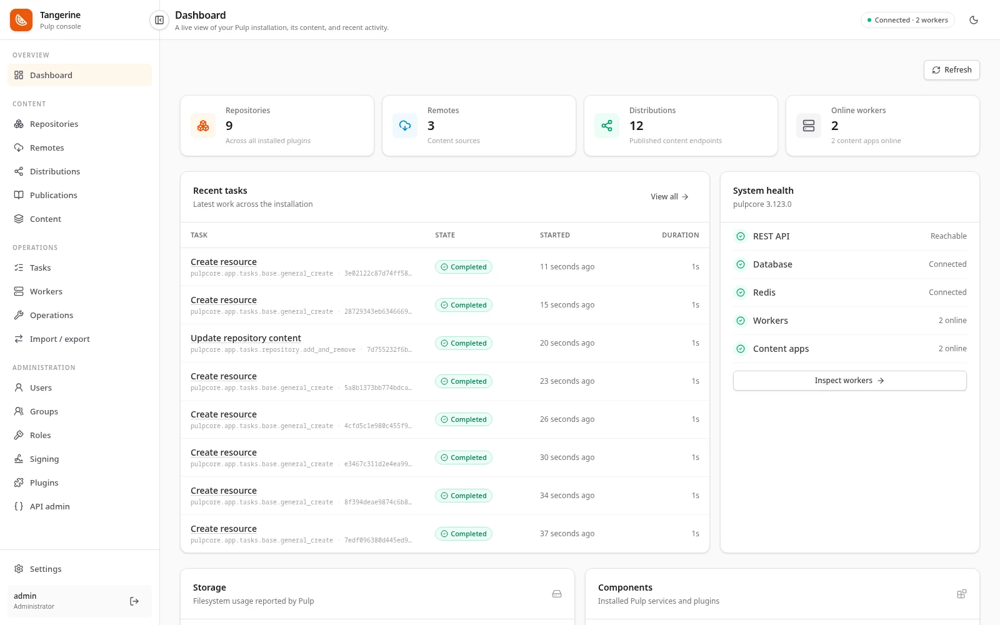
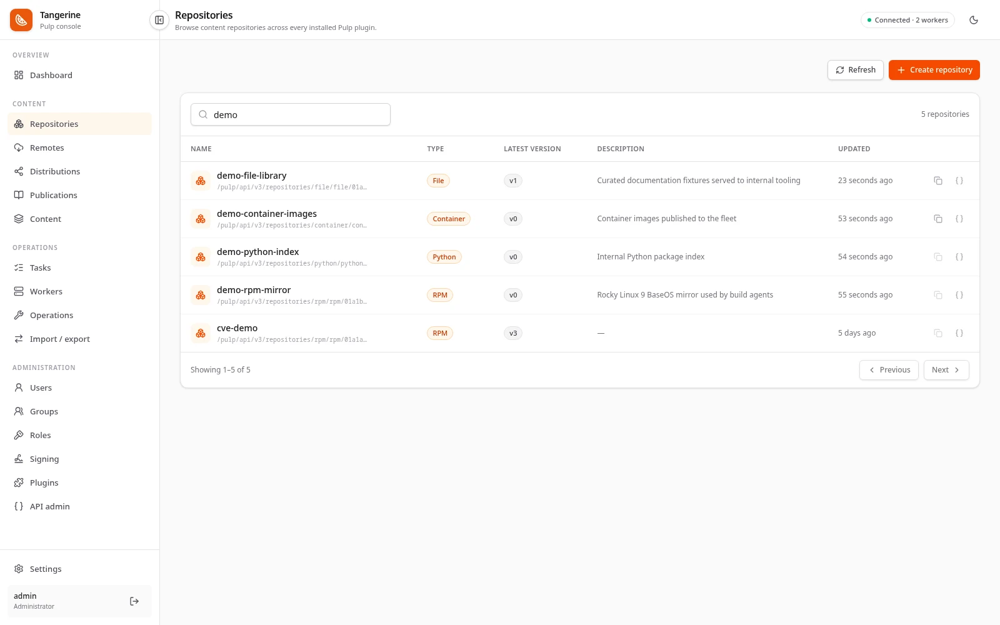
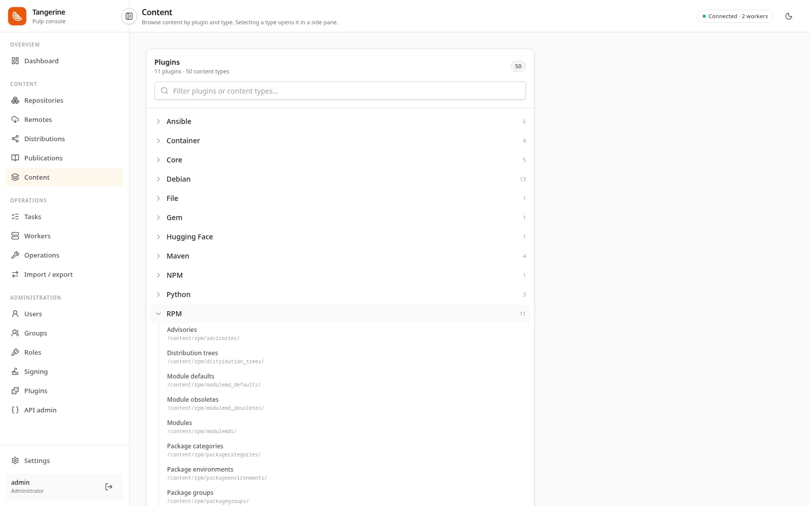
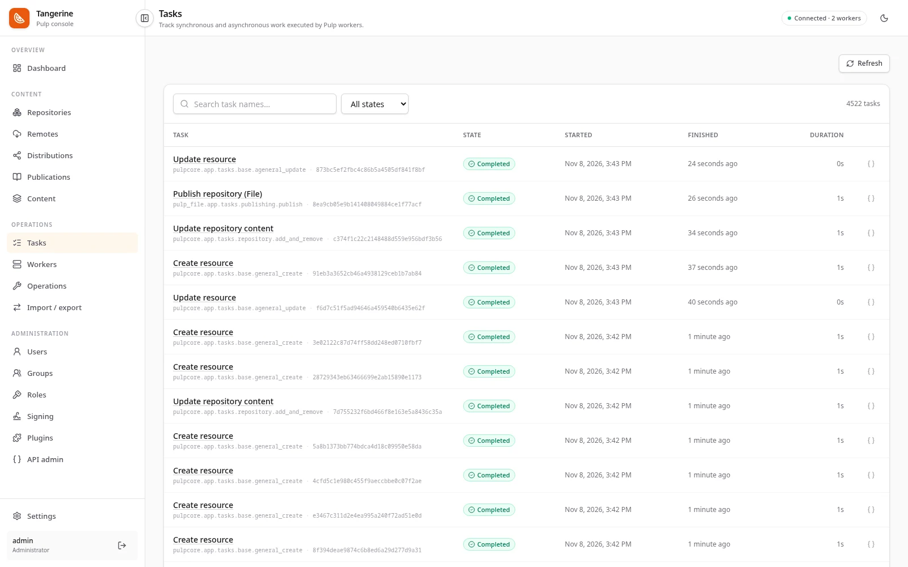

# Tangerine

A modern, full-admin web console for [Pulp](https://pulpproject.org/).

Tangerine is a static React single-page application that talks directly to the
Pulp REST API from the browser. It is not a fork of `pulp/pulp-ui`, has no
backend of its own, and is designed to run on the same origin as Pulp:

```text
https://pulp.example.com/ui/     -> Tangerine (static files)
https://pulp.example.com/pulp/   -> Pulp API and content app
```

Because the UI and API share an origin, Pulp's normal session cookie and CSRF
handling work without cross-site tricks. The optional SSO gateway is a separate
Python service that brokers OpenID Connect for stock Pulp.



## What it does

- **Repositories** — create, edit, sync, publish, scan, retain versions, and
  delete repositories across File, RPM, Debian, Python, Container, Ansible,
  Maven, NPM, and Hugging Face plugins.
- **Remotes and distributions** — create typed remotes, manage write-only
  credentials, expose content, and switch a distribution between a repository
  and a pinned publication.
- **Publications** — immutable snapshots with plugin-specific settings, filters,
  inspection, and deletion.
- **Content browser** — plugin and type discovery, server or page-scoped
  search, repository filters, package/version grouping, uploads, and OSV
  vulnerability badges.
- **Tasks and workers** — live task state, cancellation, details, workers, and
  health.
- **Operations** — orphan cleanup, artifact repair, space reclaim, schedules,
  and Pulp/filesystem import/export.
- **Users, groups, roles** — accounts, membership, role assignment, object
  roles, and custom roles.
- **Signing and plugins** — signing-service inventory, RPM repository metadata
  signing, and enabled-plugin inventory.
- **API admin** — a schema-driven request console for endpoints without a
  curated screen.
- **SSO** — optional Google, Microsoft Entra ID, Keycloak, or generic OIDC login
  through the Tangerine gateway, with declarative access rules and Pulp RBAC.
- **Fast shell** — command palette (`Ctrl`/`Cmd`+`K`), URL-backed list state,
  light/dark/system themes, and a responsive sidebar.

| Repositories | Content | Tasks |
| --- | --- | --- |
|  |  |  |

## Quick start

Requirements: Docker with Compose, Node.js `>= 22.12`, and Chromium for the
end-to-end tests.

```sh
docker compose up -d

# Set the local Pulp administrator password once the container is healthy.
docker compose exec pulp pulpcore-manager reset-admin-password --password admin

npm install
npm run dev
```

Open <http://127.0.0.1:5173/ui/> and sign in as `admin` / `admin`.

Vite proxies `/pulp` to `http://localhost:8080`, so the browser sees a single
origin exactly as it will in production. Use `PULP_PROXY` to point the dev
server at another Pulp host:

```sh
PULP_PROXY=http://pulp.example.com:8080 npm run dev
```

The compose file mounts `deploy/example/settings/settings.py`, a disposable
development settings file. It trusts localhost, enables the bundled Redis cache,
and disables token auth. Never reuse it in production.

## Production

### Build the image

```sh
docker build --build-arg VITE_BASE_PATH=/ui/ -t oneinchlunch/tangerine-ui:0.1.4 .
docker run --rm -p 8090:8080 oneinchlunch/tangerine-ui:0.1.4
curl http://127.0.0.1:8090/healthz
```

The image is static nginx. It serves `/ui/`, redirects `/` and `/ui` to `/ui/`,
falls back to `index.html` for deep links, and exposes `/healthz`.

Published images:

- `oneinchlunch/tangerine-ui`
- `oneinchlunch/tangerine-gateway`

### Helm

The chart lives in `deploy/helm/tangerine` and is published as an OCI chart:

```sh
helm upgrade --install tangerine \
  oci://registry-1.docker.io/oneinchlunch/tangerine \
  --version 0.2.4 --namespace pulp \
  --set image.tag=0.1.4 \
  --set ingress.hosts[0].host=pulp.example.com \
  --set ingress.tls[0].secretName=pulp-tls
```

`deploy/helm/pulp` deploys Pulp with Pulp Operator, an external database, and
S3-compatible object storage. The charts are separate releases so the UI and
Pulp upgrade independently. See [Installation](docs/installation.md) and
[the Helm guide](docs/developer/helm.md).

### Pulp requirements

For same-origin session authentication, Pulp needs a matching content origin,
trusted CSRF origins, and secure cookies in production:

```python
ALLOWED_HOSTS = ["pulp.example.com"]
CONTENT_ORIGIN = "https://pulp.example.com"
CSRF_TRUSTED_ORIGINS = ["https://pulp.example.com"]
SESSION_COOKIE_SECURE = True
CSRF_COOKIE_SECURE = True
```

Traefik (or another ingress) must forward `X-Forwarded-Proto` and
`X-Forwarded-Host`, and the Pulp cookies must use path `/`.

## SSO

Tangerine can broker OIDC through `gateway/`, a small Python service that answers
Traefik `forwardAuth` requests with an identity header Pulp reads through
`JSONHeaderRemoteAuthentication`. It supports Google Workspace, Microsoft Entra
ID, Keycloak, and generic OIDC providers, declarative group/role access rules,
domain policy, and scheduled directory sync.

SSO is optional. The default login mode is Pulp's local session form. Start with
the [SSO runbook](docs/sso.md); it covers the gateway deployment, Pulp settings,
Traefik middlewares, provider registration, access rules, verification, and
troubleshooting step by step.

## Documentation

| Guide | Contents |
| --- | --- |
| [User guide](docs/README.md) | Every screen and workflow, with screenshots |
| [Installation](docs/installation.md) | Local stack, first admin, production build, Helm |
| [Configuration](docs/configuration.md) | `config.json`, auth modes, base paths, polling |
| [SSO runbook](docs/sso.md) | End-to-end OIDC setup for all supported providers |
| [Signing](docs/signing.md) | RPM metadata signing, keys, verification, rotation |
| [Troubleshooting](docs/troubleshooting.md) | Common startup, auth, and content problems |
| [Developer guide](docs/developer/architecture.md) | Architecture, data layer, testing, gateway, Helm, releases |
| [Contributing](CONTRIBUTING.md) | Development workflow and review expectations |
| [Security](SECURITY.md) | Reporting and security model |

## Development

```sh
npm run typecheck
npm run lint
npm run format:check
npm run test:unit
npm run build
npm run check:bundle
npx playwright test
npm run test:gateway
```

See [Development](docs/developer/development.md) and
[Testing](docs/developer/testing.md) for the full workflow.

## License

Apache License 2.0. See [LICENSE](LICENSE).
