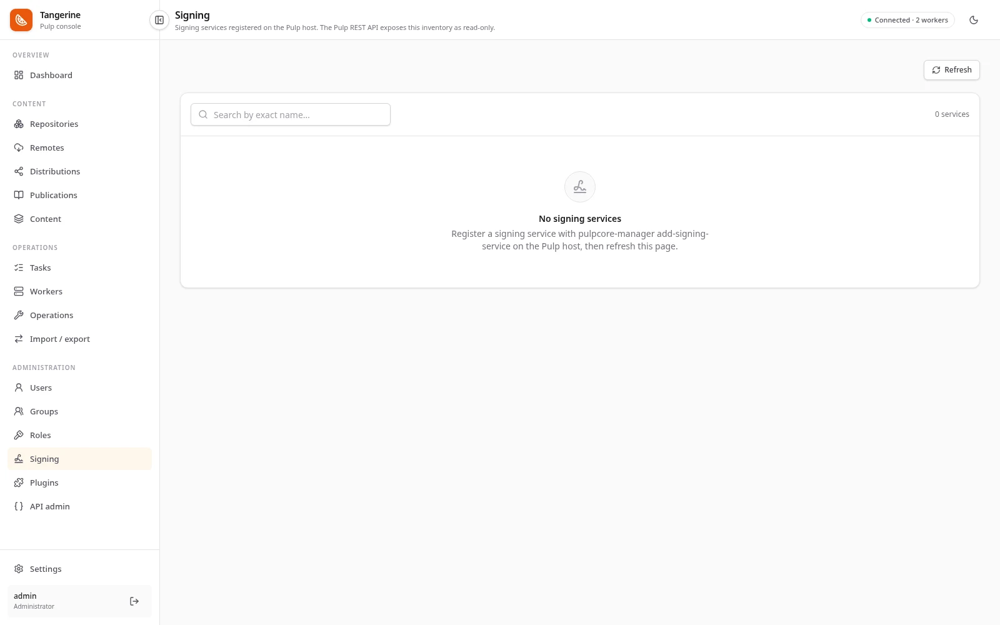
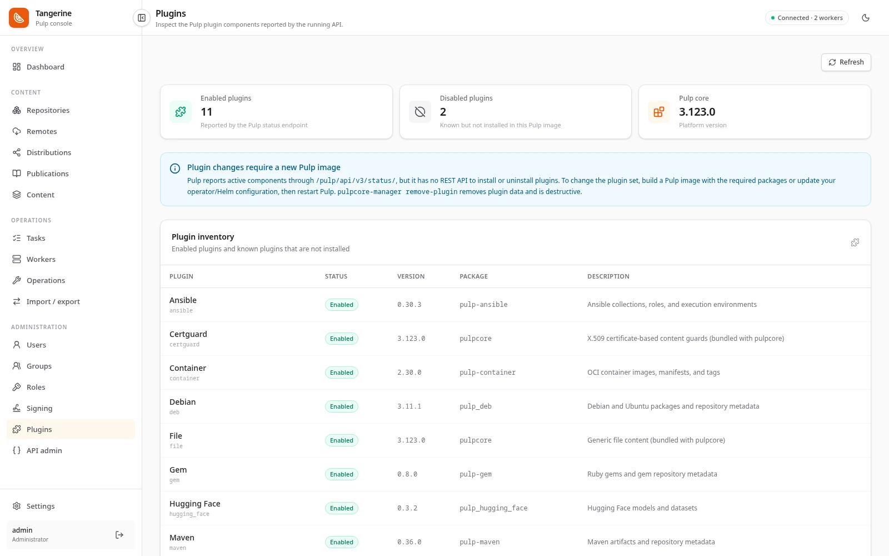
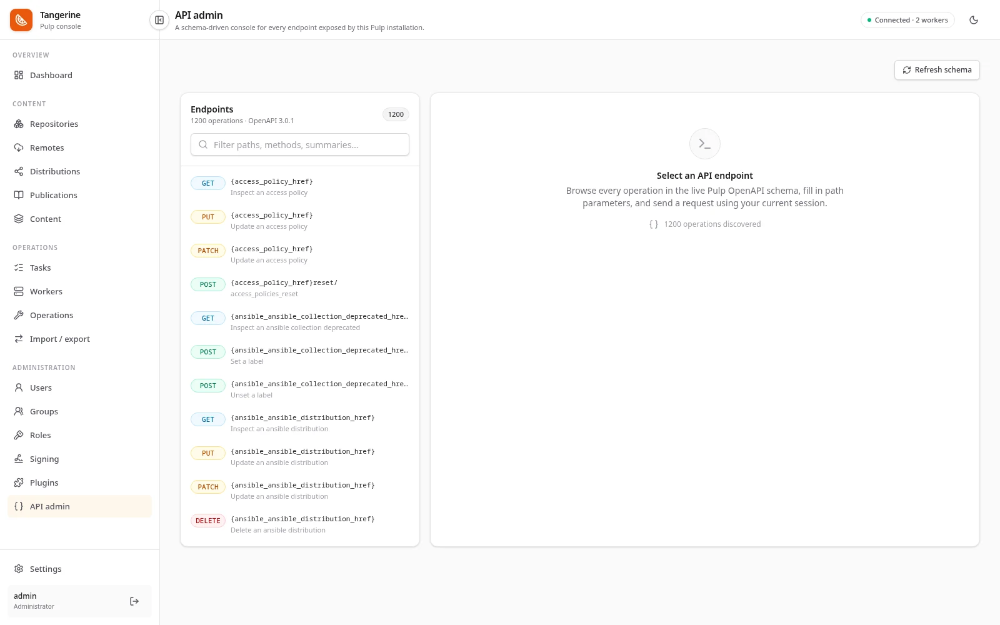
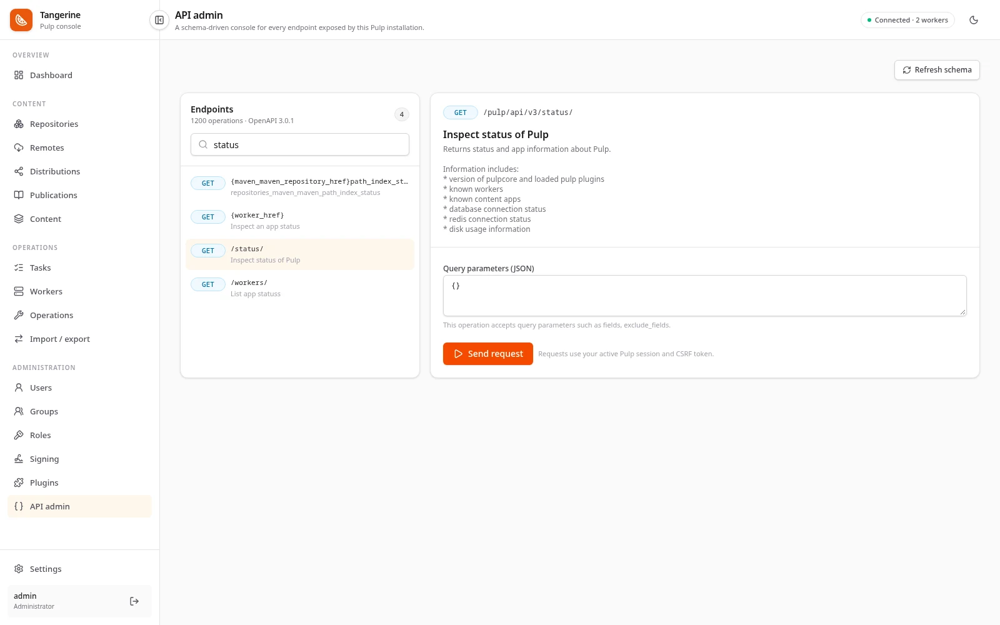
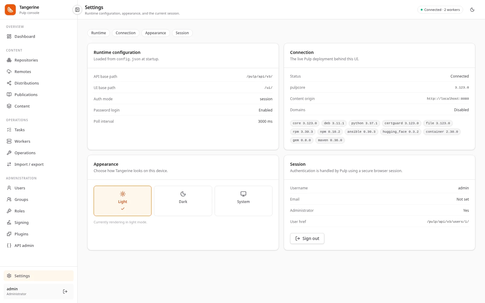

# Administration

The Administration group holds the screens that describe or reach beyond the curated workflows:
signing services, the plugin inventory, the schema-driven request console, and runtime settings.

## Signing services



Pulp's REST API exposes signing services read-only, so this screen is inventory-only. It lists the
registered services with their name, type, and API href. An empty state explains how to register one.

Register a signing service on the Pulp host, then refresh:

```sh
pulpcore-manager add-signing-service <name> <script> <key-id> \
  --class signing_service.RSAProgressReport
```

Signing is per-plugin. Tangerine exposes RPM repository metadata signing
(`metadata_signing_service`, which signs `repomd.xml`) and Debian APT release
signing (`signing_service`). It does not expose package signing, which would
sign arbitrary uploaded RPMs with the instance key. Only trusted staff see the
signing fields; repository-scoped SSO admins do not, and the gateway rejects
signing fields in scoped writes. If the list is empty, no service is
registered — the UI cannot create one for you.

## Plugins



The Plugins page reads `status/` and shows two things:

- **Enabled components** — plugins the running Pulp image loaded, with version, package, and a short
  description.
- **Known but not installed** — entries from Tangerine's catalog that are absent from `versions[]`.
  They are shown as disabled so you can see what the UI supports before installing anything.

The callout is deliberate: Pulp has no REST API for installing or uninstalling plugins. Changing the
plugin set means building a new Pulp image or updating an operator/Helm configuration. The
`pulpcore-manager remove-plugin` command deletes plugin database data and is not an uninstall
button.

## API admin



API admin is the escape hatch for everything without a curated screen. It fetches the live OpenAPI
document from `docs/api.json` and flattens it into 1200+ operations — the count depends on installed
plugins.

- **Filter** searches paths, methods, and summaries.
- Selecting an operation shows its summary, description, and the fields derived from the schema.



The request panel supports:

- **Path parameters** as individual inputs, generated from the path template;
- **Query parameters** as JSON, for example `{"limit": 10, "ordering": "-pulp_created"}`;
- **Request body** as JSON, or as multipart fields when the operation consumes
  `multipart/form-data`;
- **Send request**, which uses the current session and CSRF token, then shows status, headers, and
  the response body with a copy action.

Requests run with your permissions. Destructive calls are not confirmed beyond the button press —
double-check the method and path before sending a `DELETE` or `PATCH`.

Good uses of API admin:

- deleting a distribution (the curated UI intentionally omits it);
- running scoped repository reclaim, task cleanup, or task purge;
- exporting or importing without a curated form;
- inspecting an object whose detail page does not show the field you need.

## Settings



Settings is four cards:

| Card | Contents |
| --- | --- |
| Runtime configuration | API base path, UI base path, auth mode, password-login state, poll interval, and any gateway settings. Read-only, because it is loaded from `config.json` |
| Connection | Status, `pulpcore` version, content origin, domain support, and the full plugin version list |
| Appearance | Light, Dark, or System theme for this device |
| Session | Username, email, administrator flag, user href, and sign-out |

Two details are worth knowing:

- **Administrator** reflects Pulp's `is_staff`, not superuser status. A superuser without
  `is_staff` shows "No".
- Runtime configuration is fixed at page load. Changing `/ui/config.json` on the server requires a
  reload, and changing `uiBasePath` also requires rebuilding the image with a matching
  `VITE_BASE_PATH` because the asset paths are compiled in.

### Single sign-on settings

When the deployment runs in gateway mode, additional cards appear below Settings with the
identity-provider configuration served by the gateway: the provider list, gateway status (including
a self-test of the identity-header path), and the Pulp bootstrap account. Providers are data in the
gateway's database, not in `config.json`, and adding one is a privileged operation.

The provider form includes Google/Microsoft/Keycloak presets, pre-save discovery with issuer
correction, a copyable redirect URI with an HTTPS warning, secret-file preflight, declarative access
rules, a baseline group and roles, opt-in strict membership, an email/UPN domain allowlist, and
username-claim and verified-email options. Saved Google/Entra providers also offer IdP group search
for rule values. The admin-only preview login shows the username, group/role and group-role diffs,
baseline/strict state, and a domain rejection without writing to Pulp.

The same screen provides provider import/export, a provider-change audit log, mounted-secret status,
and a read-only access-policies card. Apply the read-only users/roles/signing policies with
`gateway/scripts/bootstrap_access_policies.py --apply`; deployment automation may run it after Pulp is ready.

Gateway mode never auto-redirects unauthenticated visitors; that is what prevents a provider outage
from becoming a login loop. Use `authMode: "external"` if the ingress handles authentication and you
want an automatic bounce.

## Where to go when a screen is missing

If a Pulp capability has no curated screen, it usually falls into one of these buckets:

1. **Read-only by API design** — signing services, plugin inventory. The UI explains the server-side
   command instead of faking an action.
2. **Needs a curated workflow** — open an issue. Repository, remote, distribution, publication, RBAC,
   and import/export screens all started this way.
3. **Long tail** — use API admin. It is a request console, not a form generator, but it covers every
   endpoint the installation exposes.

---

Back to the [guide index](README.md).
