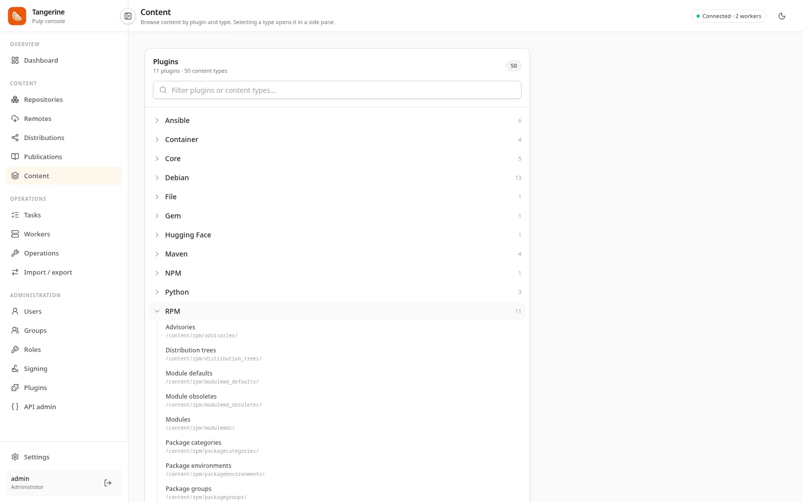
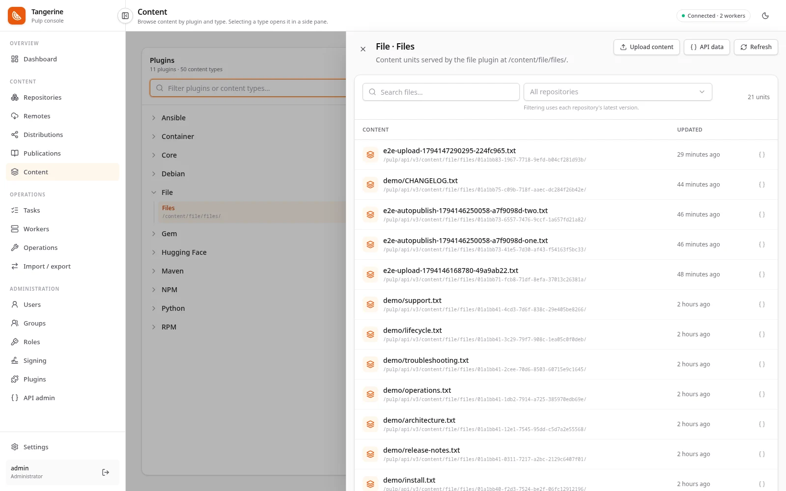
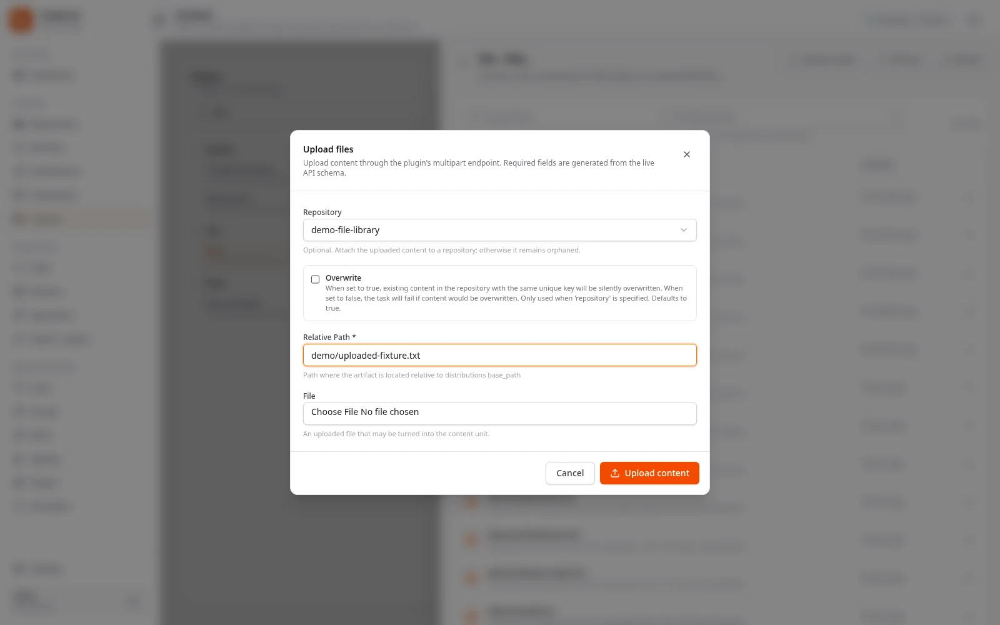

# Content

Pulp stores content units per plugin and type. There is no single flat content listing: `/content/`
returns an empty list, and real units live under `/content/<plugin>/<type>/`. Tangerine discovers
those endpoints from the API root, so the browser always matches the plugins actually installed.

## Browsing plugins and content types

The left pane lists the installed plugins. Expand a plugin to see its content types, with the API
endpoint under each name. The count beside a plugin is the number of content types it exposes.

- **Filter plugins or content types** narrows both levels. Matching plugins expand automatically,
  and the endpoint path is included in the match.
- Selecting a type opens its units in a right-side pane over the plugin list and highlights the row.
- Close the pane with the **X** at its top left, by clicking the dimmed backdrop, or with Escape.
- The selection is stored in the URL as `?plugin=rpm&type=packages`, so refresh, Back, and shared
  links restore the same pane.

## Viewing units

The pane shows the units of the selected type, their API href, version or secondary detail, size,
and update time. The label uses the most descriptive field the type exposes — a file path,
package name, advisory title, module name, or distribution release — rather than the API href. The
`{}` action opens the raw API record inside the same pane, replacing the unit list until you choose
**Back to content**. Escape closes the record view first and keeps the pane open; a second Escape
closes the pane.

Switching types clears the previous `q` and `page` parameters, so a search or page number never
carries into a different content type.

## Filtering by repository

The repository picker beside the content search limits the pane to one or more repositories. The
selection is stored as `?repos=<href>,<href>` and applies to both **Packages** and **Units**, so
refresh, Back, and shared links keep the scope.

- **All repositories** is the default and includes orphaned content.
- One repository filters with Pulp's `repository_version` parameter; several are combined with
  Pulp's expression filter. Pulp caps expression complexity at eight, so the picker allows up to
  seven repositories at a time.
- Filtering uses each repository's **latest version**. Repositories without a version are disabled
  in the picker and their chips are marked `no versions`.
- Selected repositories appear as removable chips. **Clear** removes the whole scope. A banner above
  the plugin list also shows when a repository filter is active.
- A repository's detail page has **View content**, which opens this page with that repository
  already selected. Content that exists only in older versions is not shown.

## Packages and versions

Versioned content collapses into one row per package name. RPM, Python, Debian, RubyGems, NPM,
Maven, and Ansible collection/role content default to the **Packages** view; files, container tags,
advisories, and repository metadata have no versions to group and stay flat.

- **Package** lists the name once, with a **Variants** count of the content units behind it.
- **Highest version** uses epoch-aware RPM ordering for RPM content and numeric-aware ordering for
  other package types. A package whose units continue on an unloaded page shows `—` until you choose
  **Load more packages**, so the list never claims a highest version it has not seen.
- **Details** show the distinct architectures, platforms, streams, or package types compactly.
- Selecting a package opens its **versions** view in the same pane. Every variant is listed newest
  first with its version, details, update time, and `{}` API data action. **Back to packages**, Escape,
  or the URL restore the grouped list.
- Package views are linkable: `?plugin=rpm&type=packages&package=nginx` opens `nginx`'s versions
  directly. Closing the package or switching types clears the parameter.
- Switch to **Units** for the flat per-unit list. The choice is stored as `?view=units`, and the
  toggle appears only for content types that support grouping.
- Lists load in pages of 250 units with **Load more packages**, because Pulp has no distinct-name
  endpoint. A search narrows the server query before grouping; without one, the pane reports how
  many units of the collection are loaded.

## Vulnerabilities

Each version row can carry a CVE badge built from Pulp's vulnerability reports. Severity chips show
advisory counts as `C`/`H`/`M`/`L`/`U` (critical, high, medium, low, unknown); a scanned version
with no advisories shows **Clean**, and a version with no report yet shows **Not scanned**.

- Selecting the chips opens the advisories inside the same pane: severity, OSV id (linked to
  osv.dev), the summary, CVE aliases, and the fixed version when OSV reports one.
- Severity comes from the vendor label in the OSV advisory, then the CVSS 3.0/3.1 vector. Badge
  counts are advisories; the details show how many distinct CVEs they cover.
- Escape and **Back to versions** return to the version list.
- Reports only exist after a repository version has been scanned. RPM scans need `osv_config`;
  see the repository guide. Python scans use the repository version scan endpoint.

## Searching units

Search updates while you type. Pulp does not expose one text-search field for all content types, so
Tangerine uses a debounced server-side filter where the type has a `__contains` filter and otherwise
filters the loaded page immediately:

| Content types | Search |
| --- | --- |
| File files | `relative_path__contains` |
| RPM packages | `name__contains` |
| Python packages | `name__contains` |
| Debian packages | `package__contains` |
| Ansible namespaces | `name__contains` |
| Container signatures | `name__contains` |
| OpenPGP user IDs | `user_id__contains` |
| Everything else | Filters the current page only |

For page-scoped types the header reports `X of 25 on this page`; the grouped package list reports
`X of Y loaded packages` instead. RPM advisories are the common case: Pulp exposes exact `id`,
`severity`, `status`, and `type` filters there, but no title search, so the page filter is
deliberately limited rather than silently pretending to search every advisory.

Ordering is deliberately not sent by this screen. Several content endpoints reject
`ordering=-pulp_last_updated` — RPM package groups, Python yanks, and some Ansible and Maven types —
and a generic screen that guesses would break on them. Use the search and pagination controls, or
[API admin](administration.md#api-admin) when you need a specific ordering.

## Uploading content

**Upload content** opens a multipart dialog generated from the live schema for the selected type.
For File content that means:

| Field | Notes |
| --- | --- |
| Repository | Optional. Attaching it adds the new unit to the repository and creates a version |
| Overwrite | Only meaningful with a repository; when off, Pulp fails if the unit already exists |
| Relative path | Required, unique within the repository |
| File | The artifact to upload |

Because the fields come from the plugin schema, other content types ask for their own required
values — Python package metadata, RPM fields, and so on.

The upload is asynchronous. Tangerine waits for the task, then refreshes the list and the
repository's version history, so the new unit is visible immediately.

Uploading without a repository leaves the unit orphaned. It exists and appears in this browser, but
no repository version references it; a later orphan cleanup can remove it. Attach content to a
repository unless you are staging it deliberately.

## What this screen is not

Content is treated as read-only apart from uploads. Editing or deleting an individual unit is not
offered, because Pulp models content as immutable: you create a new repository version instead.
Removing content from a repository is done by modifying the repository through
[API admin](administration.md#api-admin), or by uploading a replacement and republishing.

---

Next: [Tasks](tasks.md)
