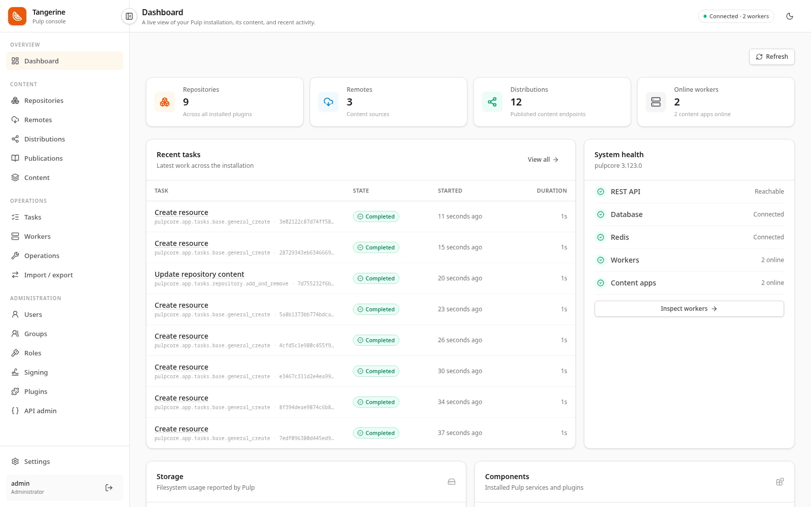

# Dashboard

The dashboard is the landing page after sign-in and answers three questions: how much content this
installation holds, what has run recently, and whether the services behind Pulp are healthy.

## Counts

The four tiles across the top are live totals from Pulp:

| Tile | Source |
| --- | --- |
| Repositories | Combined `/repositories/` count across every installed plugin |
| Remotes | Combined `/remotes/` count |
| Distributions | Combined `/distributions/` count |
| Online workers | Workers that reported a heartbeat inside Pulp's worker TTL |

Clicking a tile is not required to drill in — the sidebar links to the same lists. The counts
refresh on the configured poll interval (3 seconds by default) and whenever you press **Refresh**.

## Recent tasks

The recent tasks card lists the newest work across the whole installation, formatted with readable
names such as *Publish repository (File)* or *Update repository content* instead of raw task
imports. Each row shows the state badge, when the task started, and its duration.

- Select a row to open the full task detail, including progress reports and created resources.
- **View all** opens the Tasks screen with the same data plus search and state filtering.
- Rows appear here for every asynchronous operation, including ones started from the CLI or another
  client — the dashboard is not limited to actions taken in Tangerine.

See [Tasks](tasks.md) for the detail view and cancellation.

## System health

The health card performs independent checks and reports each one separately:

| Check | Meaning |
| --- | --- |
| REST API | The `status/` endpoint answered. If this is unreachable, the whole page falls back to an error state. |
| Database | Pulp's PostgreSQL connection. |
| Redis | The cache/broker connection. "Not configured" means the deployment runs without `CACHE_ENABLED`; that is valid for small installs but disables some task coordination. |
| Workers | At least one worker is online. Zero online workers means tasks will queue and never start. |
| Content apps | At least one content app is online. Without one, distributions still exist but clients cannot download content. |

A red row is not automatically an error in Tangerine: it mirrors what Pulp reported. If Redis is
red but tasks still run, the deployment may simply not use the cache.

**Inspect workers** jumps to the worker inventory, where you can see heartbeats, current task, and
the plugin versions each worker loaded.

## Storage and components

Scrolling down reveals two more cards:

- **Storage** shows artifact storage usage when the storage backend exposes metrics. Backends that
  cannot report free space display "Storage metrics are not available for this backend" rather than
  inventing a number.
- **Components** lists every plugin the API reports, with version badges. This is the fastest way
  to confirm which plugins a deployment actually loaded before you look for a screen that depends
  on one.

For a plugin-by-plugin inventory including known-but-not-installed plugins, use
[Plugins](administration.md#plugins).

---

Next: [Repositories](repositories.md)
