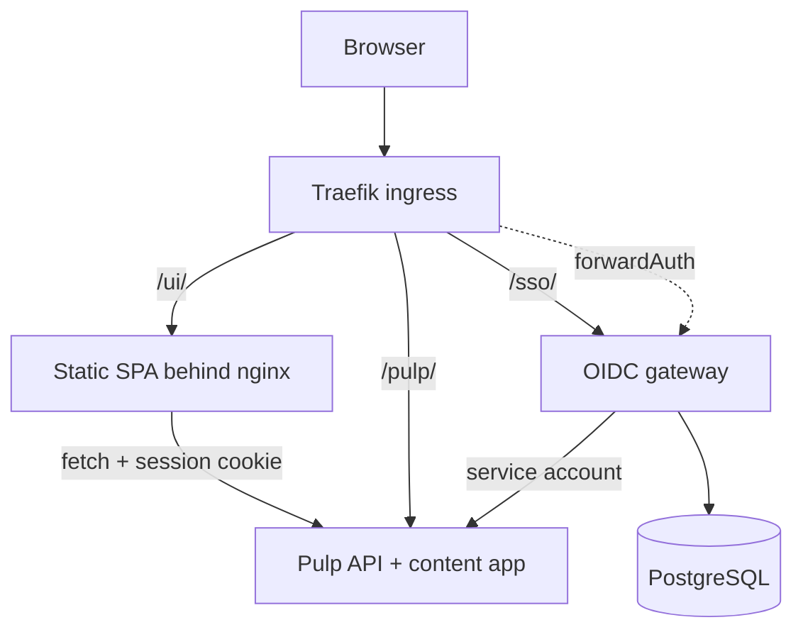
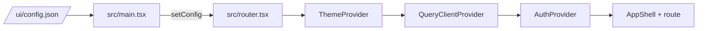
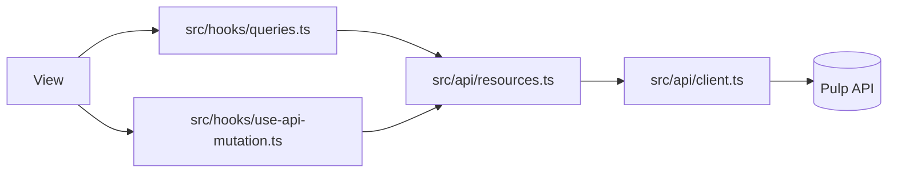

# Architecture

Tangerine is a static single-page application that renders Pulp's REST API, plus
an optional Python gateway that brokers OIDC.

There is no Tangerine backend for the UI. nginx serves files; every read and
write is a Pulp API call made by the browser with the user's Pulp session. The
optional gateway has its own PostgreSQL store for providers, sessions, pending
login states, and audit.

## Bootstrap

`src/main.tsx` loads `/ui/config.json`, stores it, creates the code-based router
with the configured base path, and mounts the providers.

## Routing and auth gate

All routes live in `src/router.tsx`; there is no generated route tree. Feature
routes are lazy-loaded to keep the initial bundle small.

`RootComponent`:

- loading -> splash screen;
- no user -> redirect to `/login`;
- unauthenticated on `/login` -> render the login page directly;
- authenticated on `/login` -> redirect to `/`;
- otherwise render `AppShell`.

Detail routes use `?href=<pulp_href>`. Lists keep query, page, page size, and
sort in the URL.

## Auth and CSRF

1. `POST /pulp/api/v3/login/` with Basic credentials and `{}`.
2. Pulp sets the HttpOnly `sessionid` and readable `csrftoken` cookies.
3. `GET /login/` returns the identity; the full user record is fetched from its
   href when permitted.
4. `DELETE /login/` removes the session; the UI repeats until `GET /login/`
   returns `401`.

`src/api/client.ts` is the only HTTP client. It adds the CSRF header for writes,
uses same-origin credentials, normalizes Pulp hrefs, and throws a structured
`ApiError`.

## SSO gateway

The gateway is an OIDC relying party. It owns the login flow, stores provider
configuration in PostgreSQL, and answers Traefik forwardAuth requests with an
identity header Pulp trusts. It also reconciles Pulp users, groups, group roles,
and staff/superuser flags at login.

See [Gateway](gateway.md) and the [SSO runbook](../sso.md).

## Data layer

- `apiRequest` / `apiRequestWithStatus` for one-off calls.
- `pulpApi.*` for common operations.
- `listResource`, `listAllResource`, `useAllList`, `useLoadMoreList`, and
  `useApiPages` for pagination.
- React Query hooks own screen data and polling.
- `useApiMutation`, `usePulpWrite`, `usePulpDelete`, and `useScopedMutation` own
  writes and invalidation.
- `query-keys.ts` is the key factory; `invalidations.ts` resolves prefixes.
- Await `202 { task }` responses before invalidating.

## UI composition

| Concern | Component |
| --- | --- |
| Page title/subtitle | `PageHeader` + page-header context |
| Staff-only screens | navigation flags + `AdminGate` |
| Capability-gated screens | `CapabilityGate` |
| Tables | `ResourceList`, `Table` primitives |
| Dialogs | `Modal`, `ConfirmDeleteModal`, `useFormState` |
| Bottom panes | `BottomPane`, API data pane |
| Pickers | `Combobox`, `MultiCombobox` |
| Feedback | toast store + mutation hooks |
| Command palette | `QuickSwitcher` |
| Unsaved work | dirty-state dialog guard |

The shell is full-bleed; wide screens use the `3xl` breakpoint. The sidebar
collapses to an icon rail on desktop and an off-canvas drawer on mobile.

## Key files

| Path | Role |
| --- | --- |
| `src/main.tsx` | Config load and provider bootstrap |
| `src/router.tsx` | Every route and the auth gate |
| `src/api/client.ts` | Fetch wrapper, CSRF, href normalization, errors |
| `src/api/resources.ts` | Pulp operations, href helpers, task waiting |
| `src/hooks/queries.ts` | Screen data and polling |
| `src/hooks/use-api-mutation.ts` | Shared write path and invalidation |
| `src/lib/plugins.ts` | Plugin endpoints, capabilities, labels |
| `src/lib/content-packages.ts` | Package grouping and version ordering |
| `src/lib/vulnerabilities.ts` | OSV severity and CVSS |
| `gateway/tangerine_gateway/` | OIDC relying party and Pulp identity bridge |
| `deploy/helm/tangerine/` | UI chart |
| `deploy/helm/pulp/` | Pulp chart |

## Invariants

1. Same origin for UI and API; cookies use path `/`.
2. `VITE_BASE_PATH == config.uiBasePath == ingress path`.
3. Pulp hrefs are opaque; normalize through helpers.
4. One HTTP client, one server-state library.
5. Plugin differences live in `src/lib/plugins.ts`.
6. Never persist credentials in browser storage.
7. The SSO identity header is safe only with edge stripping and enforced
   NetworkPolicy.
