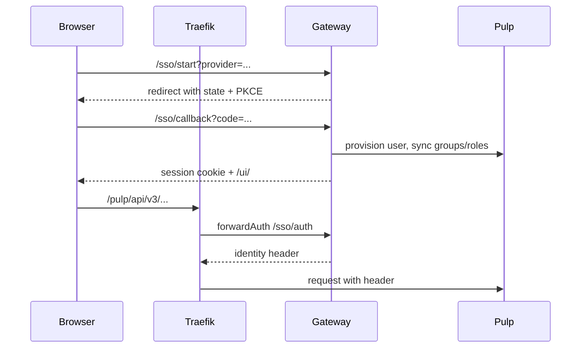

# Gateway

The optional OIDC gateway lives in `gateway/`. It lets an identity provider sign
users into a stock Pulp installation by answering Traefik forwardAuth requests
with an identity header Pulp trusts.

See the [SSO runbook](../sso.md) for deployment steps and the full
`gateway/README.md` for the environment reference and operational runbook.

## Components

| Module | Role |
| --- | --- |
| `main.py` | OIDC routes, provider admin, forwardAuth, health |
| `reconcile.py` | User, group, role, and staff/superuser reconciliation |
| `rules.py` | Provider access rules and cross-provider role union |
| `scope.py` | Repository PRN scopes and scoped role injection |
| `scope_routes.py` | `/sso/scope/*` validated writes |
| `directory.py` | Directory snapshots, deprovision, reactivate |
| `rate_limit.py` | Per-IP and global token buckets for start/callback |
| `cli.py` | Migrate, roles, secrets, reconcile, prune, sync-directory |
| `oidc.py` | Discovery, PKCE, issuer validation, token validation |
| `store*.py` | SQLite/PostgreSQL persistence and schema migrations |
| `domain_policy.py` | Email/UPN allowlist and Google `hd` enforcement |

## Flow



## Endpoints

| Endpoint | Purpose |
| --- | --- |
| `GET /providers` | Enabled providers for the login screen |
| `GET /start?provider=&next=` | Discovery, PKCE, state |
| `GET /start?provider=&preview=1` | Admin-only no-write preview |
| `GET /callback` | Validate state/token, provision, set session |
| `GET /auth` | forwardAuth target |
| `GET /session` | Identity, capabilities, CSRF token |
| `POST /logout` | Revoke session and redirect to IdP logout |
| `/admin/*` | Provider CRUD, discovery, groups, secrets, audit, policies |
| `/scope/*` | Validated repository-scoped writes |
| `/healthz`, `/readyz` | Probes |

## Storage

Production uses PostgreSQL. Migrations run at startup under an advisory lock so
multiple replicas can start together. Sessions, login states, audit rows, and
identity assertions are purged on a timer.

Provider secrets are files under `TANGERINE_SECRETS_DIR`; the database stores
only file names.

## Provisioning

At login the gateway:

1. enforces domain policy before any write;
2. creates the Pulp user if needed;
3. resolves access rules and legacy maps;
4. reconciles group membership and the cross-provider group-role union;
5. applies staff/superuser flags;
6. reactivates a returning inactive account;
7. stores the assertion for optional background replay.

Errors are collected per item so one failed write cannot block a login.

## Security invariants

1. Strip inbound identity headers at the edge.
2. Enforce NetworkPolicy; verify it from another namespace.
3. Guard usernames with the managed group.
4. Restrict provider administration to trusted superusers.
5. The gateway authenticates to Pulp with its own service account.
6. Resolve a local Pulp session cookie with an unauthenticated client.
7. Do not attach forwardAuth to `/v2` or `/token`.

## Tests

```sh
npm run test:gateway
```

The suite needs no Django, Pulp, or network. It uses SQLite by default and
accepts `TANGERINE_TEST_DATABASE_URL` for PostgreSQL.
