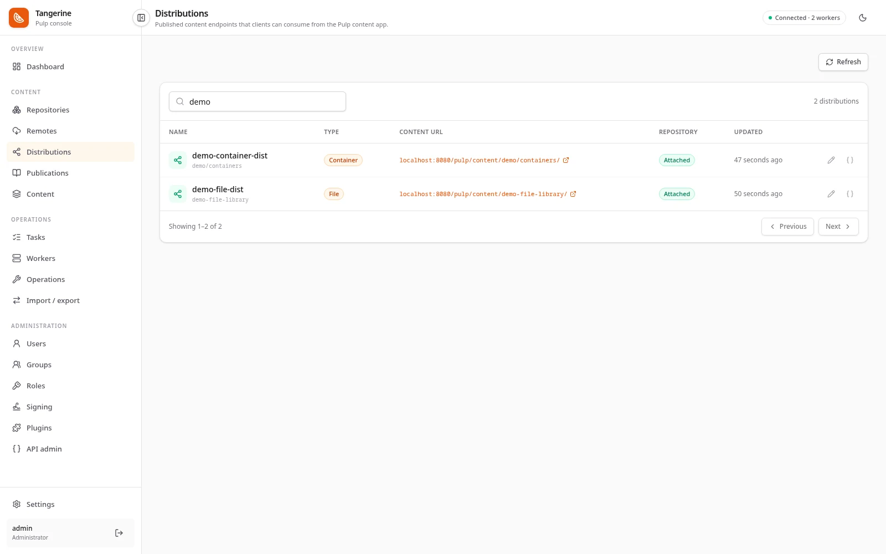
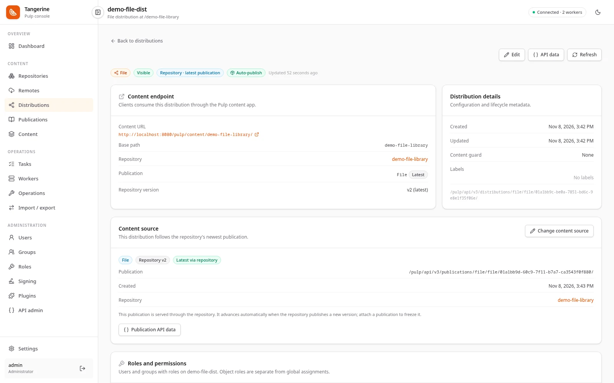
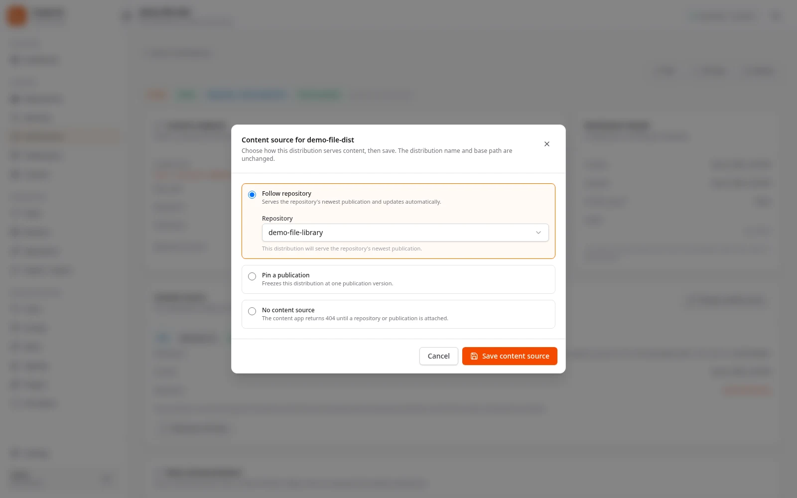

# Distributions

A distribution publishes repository content at a URL that clients can consume. It bundles three
decisions: which content source to serve, which base path to expose, and whether the endpoint is
visible or hidden.

## The distribution list

The list combines `/distributions/` across plugins and shows the name, base path, type, content
URL, whether a repository is attached, and the last update.

- **Search** filters by name (`name__contains`) and keeps the term in `?q=`.
- **Content URL** opens the content app in a new tab. The scheme is trimmed in the list to save
  space; hovering reveals the full URL.
- **Edit** opens the metadata dialog directly from the list.
- **`{}`** shows the raw API record.

The list does not delete distributions. Deletion is intentionally not exposed — too many delete
paths can break a live content endpoint by accident. If you must remove one, use
[API admin](administration.md#api-admin) against the plugin-specific distribution href.

### System distributions

Pulp core creates a singleton `core.artifacts` distribution the first time it starts with local
filesystem artifact storage. It serves stored artifacts by UUID through signed, expiring URLs,
has no repository or publication, and its API is read-only. Tangerine lists it as **Pulp artifact
serving** with a **System** badge, hides the edit actions, and explains the endpoint on its detail
page. Leave it alone: it is not part of any repository and Pulp recreates it if it disappears.

## Distribution detail

The detail page fetches the **plugin-specific** distribution record. The combined list response
omits write-only and plugin fields such as `publication`, so editing from the combined record would
silently drop information.

### Header badges

| Badge | Meaning |
| --- | --- |
| Type | The friendly distribution type, for example File, RPM, or Debian APT. Unknown types fall back to `plugin.type`. |
| System | Pulp's internal read-only artifact distribution; no edit or delete actions |
| Visible / Hidden | Pulp's `hidden` flag; hidden distributions are excluded from the content app listing |
| Follows repository / Pinned / No source | How the endpoint resolves its content |
| Auto-publish | Whether the backing repository publishes new versions automatically |

### Content endpoint

The first card is about serving:

- **Content URL** — the full URL clients use. Select it to copy.
- **Base path** — the path component, unique per distribution.
- **Repository** — the attached repository, linked to its detail page.
- **Publication** — the publication being served, or *Latest via repository* when the repository
  publishes implicitly.
- **Repository version** — which version the served publication contains.

A repository-backed distribution still serves a publication even though its `publication` field is
null. Pulp resolves the repository's newest publication at request time. If no publication exists
yet, the content app returns `404` even though the distribution itself is valid — the card says so
explicitly.

### Distribution details

Configuration and lifecycle metadata: created and updated timestamps, content guard, labels, and
the API href.

### Content source

**Change content source** opens a focused dialog with three mutually exclusive options:

| Option | Behaviour |
| --- | --- |
| **Follow repository** | Serves the repository's newest publication and advances automatically when a new version is published |
| **Pin a publication** | Freezes the endpoint on one publication version; later publishes do not affect it |
| **No content source** | Detaches both, leaving an endpoint that returns 404 until a source is attached |

Selecting an option reveals the relevant repository or publication picker. Publication choices are
scoped to the distribution's repository so you cannot pin a publication the endpoint could not
serve.

Pulp rejects a distribution that sets both `repository` and `publication`. Saving sends only the
source fields and clears the other one — metadata edits never rewrite the source.

### Editing metadata versus source

The two edit paths are separate on purpose:

- **Edit** changes the name, base path, and hidden flag. The content source is shown read-only.
- **Change content source** only touches `repository` and `publication`.

This split prevents an innocent rename from silently re-pointing a client endpoint.

### Publishing controls

When the repository supports publications, the source card also offers:

- **Publish latest version** — creates a publication for the newest repository version.
- **Enable / Disable auto-publish** — toggles the repository setting. Disabling leaves existing
  publications in place.

For direct-serve types (Container, Ansible, NPM, Maven, Hugging Face) these controls do not appear,
because publications are not part of that content path.

## Distribution types and endpoints

The type segment in the URL does not always match the repository plugin. Python is the clearest
example: repositories live under `repositories/python/python/` but distributions live under
`distributions/python/pypi/`. Tangerine resolves this mapping internally, so you pick a repository
and the right distribution endpoint is used.

## Common tasks

**Expose a repository publicly.** Open the repository, use **Add distribution**, choose a base path,
and save. Then open the distribution and confirm that a publication exists — if the repository has
no publication yet, publish its latest version first.

**Point clients at a frozen snapshot.** Open the distribution, choose **Change content source**,
select **Pin a publication**, pick the version, and save. Clients keep receiving that snapshot even
as the repository advances.

**Take an endpoint offline without deleting it.** Edit the distribution and mark it hidden, or
switch to **No content source**. Hidden keeps the URL resolvable if a client knows it; no source
returns 404.

---

Next: [Publications](publications.md)
