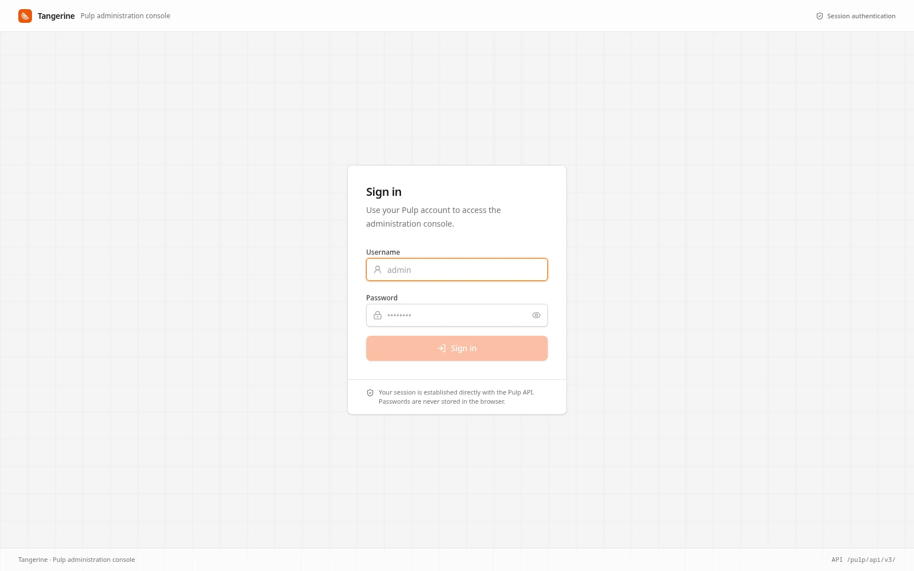
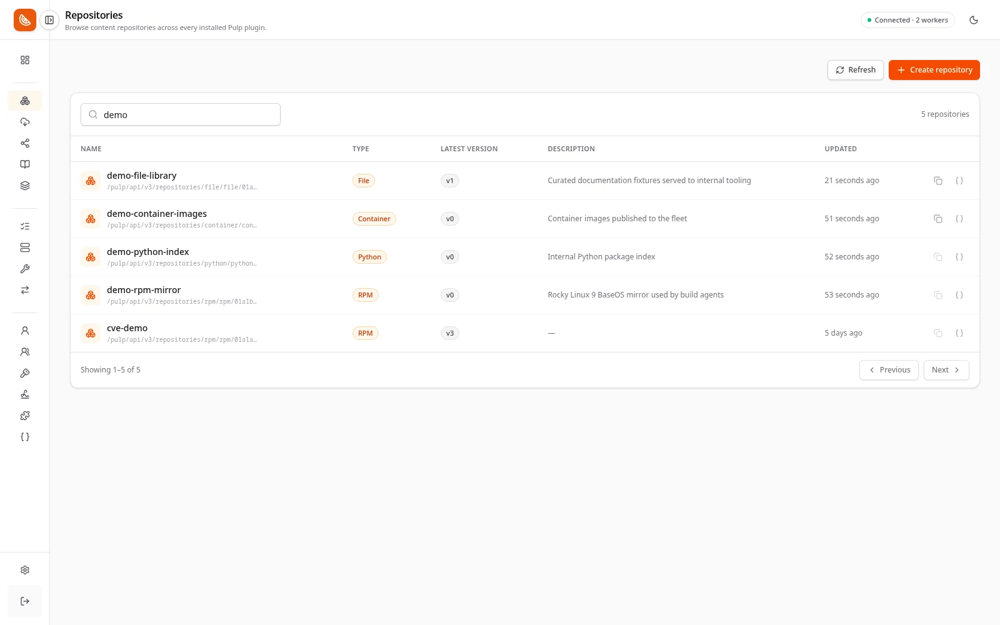

# Getting started

Tangerine is served from the same host as Pulp, normally at `/ui/`, and calls the Pulp API at
`/pulp/api/v3/`. Both paths are configurable at deploy time, but they always stay on the same
origin so the Pulp session cookie works without cross-site tricks.

## Signing in

Open the UI path — for example `https://pulp.example.com/ui/` — and you are redirected to the
sign-in page. What appears there depends on how the installation was configured:

- **Session authentication** (the default) shows the Pulp username and password form. Tangerine
  posts the credentials to Pulp's `login/` endpoint, and Pulp sets an HttpOnly `sessionid`
  cookie plus a readable `csrftoken` cookie.
- **Gateway mode** adds one button per identity provider above the password form, and may hide the
  password form entirely. Choosing a provider navigates to the SSO gateway, which owns the login
  flow and redirects back to `/ui/`.
- **External mode** shows a single continue button. Authentication happens at the ingress, before
  the UI is ever reached.

Passwords are never stored in the browser. The only credential kept client-side is Pulp's CSRF
token, which JavaScript must be able to read in order to send it back on writes.

If sign-in fails, the error message comes from Pulp itself — usually "Invalid username or
password" or a CSRF rejection. The footer of the page shows the API base path the build is
configured with, which is the first thing to check when the UI cannot reach Pulp.

## The application shell

Once signed in, every screen shares the same shell: a navigation sidebar on the left, a title bar
across the top, and the page body.

- The **top bar** shows the current page title and a one-line subtitle, plus the connection badge
  (`Connected · 2 workers`). The badge reflects the last status poll; if Pulp becomes unreachable it
  turns into a warning so you know the data on screen is stale.
- The **theme toggle** switches between light and dark rendering. Settings → Appearance offers
  Light, Dark, and System, and remembers the choice per device.
- The **quick switcher** button in the top bar (or <kbd>Ctrl</kbd>/<kbd>Cmd</kbd> + <kbd>K</kbd>)
  searches pages and Pulp resources. Results are grouped by page, repository, remote, distribution,
  task, and user; use the arrow keys and Enter, or click a result.
- A **running-task chip** appears beside the connection badge while Pulp has waiting, running, or
  cancelling tasks. Selecting it opens the Tasks page already filtered to running work.
- The **sidebar footer** shows the signed-in username, whether the account is an SSO-provisioned
  user, the `pulpcore` version, and the sign-out button.

Navigation is grouped by job:

| Group | Screens |
| --- | --- |
| Overview | Dashboard |
| Content | Repositories, Remotes, Distributions, Publications, Content |
| Operations | Tasks, Workers, Operations, Import / export |
| Administration | Users, Groups, Roles, Signing, Plugins, API admin |

Settings is pinned to the bottom of the rail, next to the account block.

The collapse control on the sidebar's right edge shrinks it to an icon rail on desktop. Each icon
keeps its accessible name and a tooltip, and the choice is remembered in `localStorage`. On narrow
windows the sidebar becomes an off-canvas drawer instead, opened with the menu button in the top
bar.

## Feedback, tables, and unsaved work

Writes report their result through a toast in the bottom-right corner. Successful writes close
their dialog or refresh their list and disappear after a few seconds; failures stay visible until
dismissed, and a write that started a Pulp task offers a **View task** link.

List screens share the same table controls:

- **Rows per page** switches between 25, 50, and 100. The choice is kept in the URL together with
  the page and search, so refresh and Back preserve it.
- **Sortable headers** show an arrow and cycle ascending, descending, and unsorted. Only columns
  Pulp can order are clickable; the content browser stays unsorted because some content endpoints
  reject `ordering`.

Dialogs that hold unsaved edits ask before throwing them away. Pressing Escape, clicking the
backdrop, using the close button, or choosing Cancel shows **Discard unsaved changes?** with
**Keep editing** and **Discard**. Untouched dialogs close immediately.

## Signing out

Use **Sign out** below the account name. The UI calls Pulp's `DELETE login/` (with CSRF), clears the
React Query cache, and returns to the login page. It repeats the logout until the session is really
gone, which matters when older deployments left stale path-scoped session cookies behind.

With the gateway, signing out also ends the gateway session so the next visit cannot silently
re-authenticate through the identity provider.

## Things that are intentionally read-only

A few Pulp concepts have no writable REST API, and Tangerine does not pretend otherwise:

- Signing services are inventory-only; register them with `pulpcore-manager add-signing-service`
  on the Pulp host.
- Plugins are reported by Pulp but cannot be installed from the API; changing the plugin set means
  a new Pulp image.
- Publications are immutable once created.

[Administration](administration.md) covers these screens in detail.

---

Next: [Dashboard](dashboard.md) · [Repositories](repositories.md)
