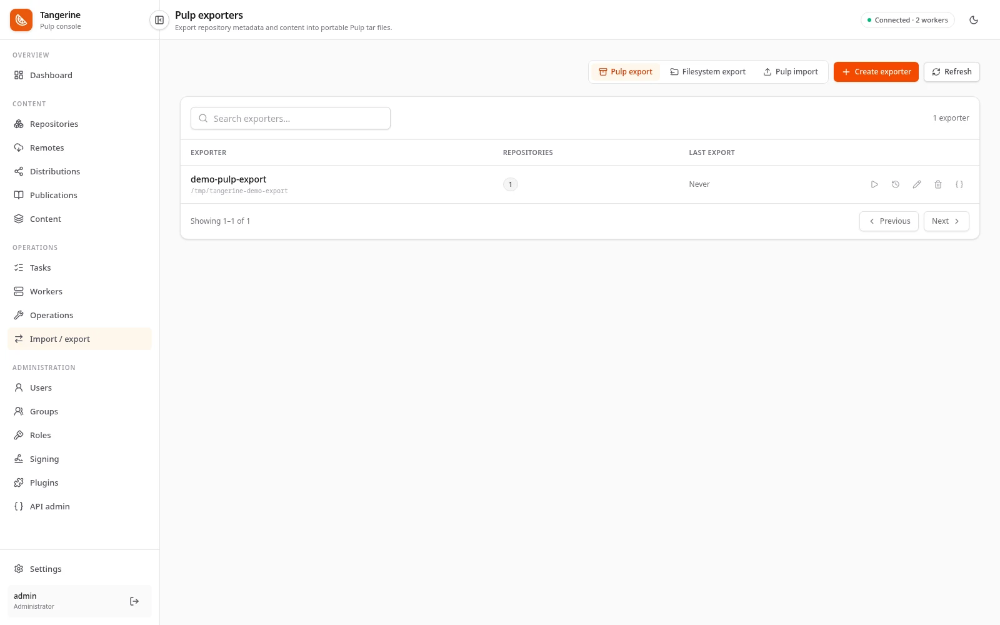
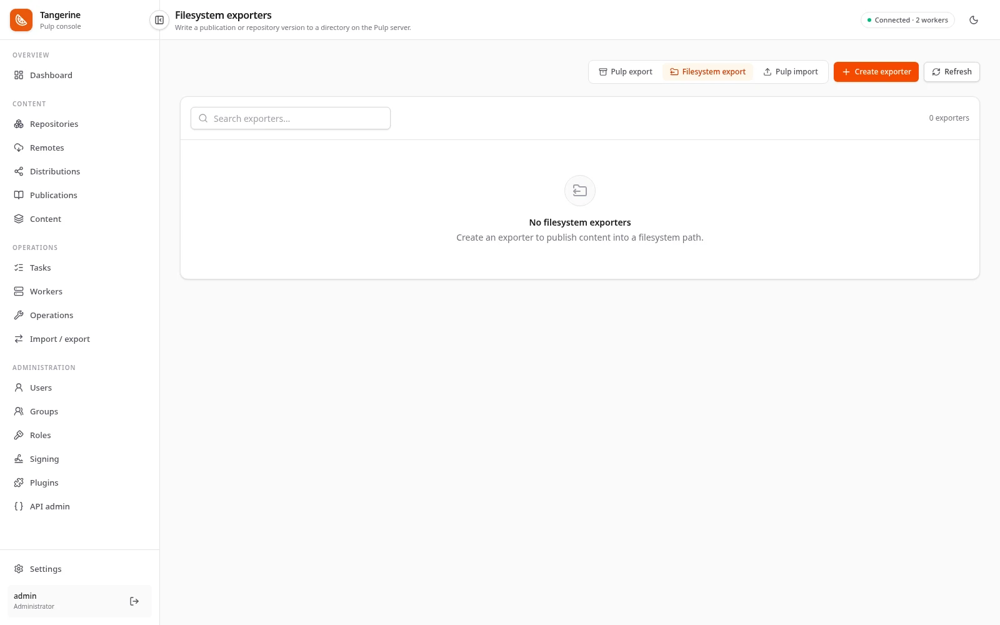
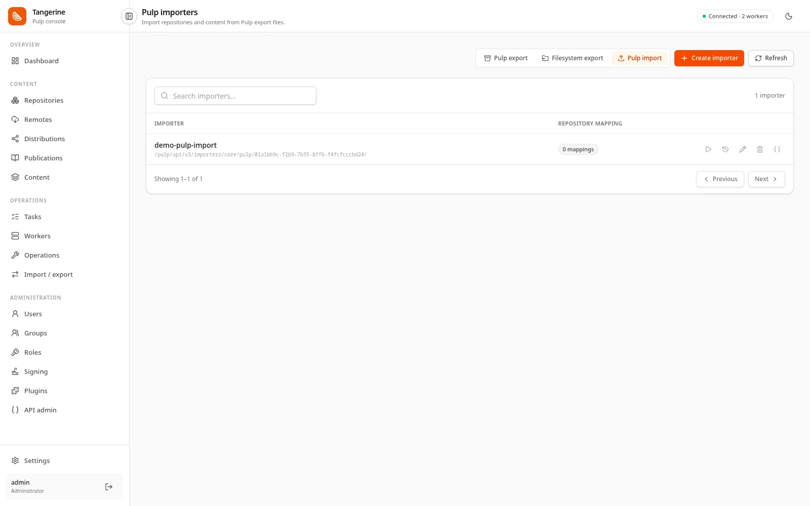

# Import and export

Tangerine can drive Pulp's three transfer features from one place:

| Tab | Purpose |
| --- | --- |
| Pulp export | Bundle repositories into a portable `tar.gz` with metadata you can move between Pulp installations |
| Filesystem export | Materialise content into a directory tree for a web server or shared filesystem |
| Pulp import | Read a Pulp export archive on the server and recreate its content |

All three are server-side operations: the UI sends paths that the Pulp server must be able to read
or write. The server only accepts export paths listed in its `ALLOWED_EXPORT_PATHS` setting.

## Pulp export



An exporter is a reusable definition: a destination directory and the set of repositories to
include.

**Create exporter** asks for:

| Field | Notes |
| --- | --- |
| Name | Unique exporter name |
| Server path | Directory on the Pulp server where archives are written, for example `/var/lib/pulp/exports` |
| Repositories | Multi-select with server-side search; pick any number of repositories |

Row actions:

- **Run** opens the export run dialog. Chunk size controls how large each archive is; explicit
  versions let you export specific repository-version hrefs instead of the latest of each repository.
- **View runs** shows previous exports for that exporter with their state and task link.
- **Edit** changes the definition.
- **Delete** removes the exporter, not the archives it already wrote.
- **`{}`** shows the raw record.

Exports are asynchronous. A finished run produces one or more archives plus a table-of-contents file
in the destination directory.

## Filesystem export



A filesystem exporter writes published content into a directory tree that another service can serve
directly — useful when a CDN or web server should read the content without going through the Pulp
content app.

The definition is a name, a server path, and a method:

| Method | Behaviour |
| --- | --- |
| Write | Copies file contents into the destination |
| Hardlink | Links files when the destination is on the same filesystem |
| Symlink | Links to the artifact store without copying |

Running one requires either a publication href or a repository version href, depending on what you
want to materialise. Incremental runs accept a start repository version, so only the delta is
written.

Hardlinks and symlinks are fast but couple the destination to the artifact store: deleting artifacts
through orphan cleanup can break a symlinked export.

## Pulp import



An importer reads an export archive that already exists on the server.

**Create importer** takes a name and an optional repository mapping as JSON. The mapping rewrites
repository names during import, which is how you restore the same archive into a differently named
installation:

```json
{
  "source-repo-name": "destination-repo-name"
}
```

Running an import asks for:

- **Export path** — the archive or directory produced by the export run;
- **Table of contents path** — optional, when the archive's TOC lives elsewhere.

Import creates the repositories and content described by the archive, then starts a task. Watch the
task detail for per-repository results; a partially failed import still reports the repositories it
did create.

## Practice notes

- Paths are validated by Pulp, not by the UI. A path outside `ALLOWED_EXPORT_PATHS` fails with a
  server error that names the allowed roots.
- The local compose stack allows `/tmp`, which is why the demonstration exporter uses
  `/tmp/tangerine-demo-export`. Production deployments normally allow a dedicated volume instead.
- Exports and imports are the supported way to move content between instances. Copying the database
  or artifact store by hand is not equivalent and will usually produce checksum mismatches.
- Filesystem exports are not snapshots: a later export into the same directory updates the tree.

---

Next: [Administration](administration.md)
