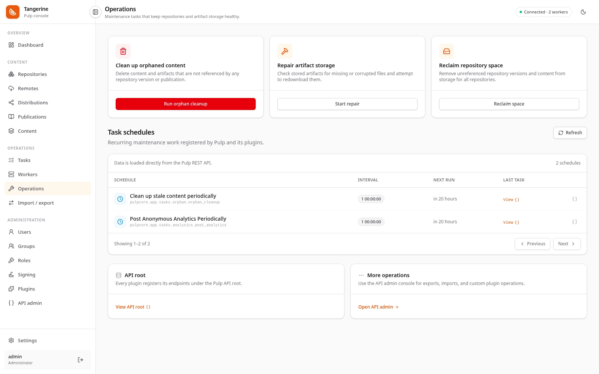
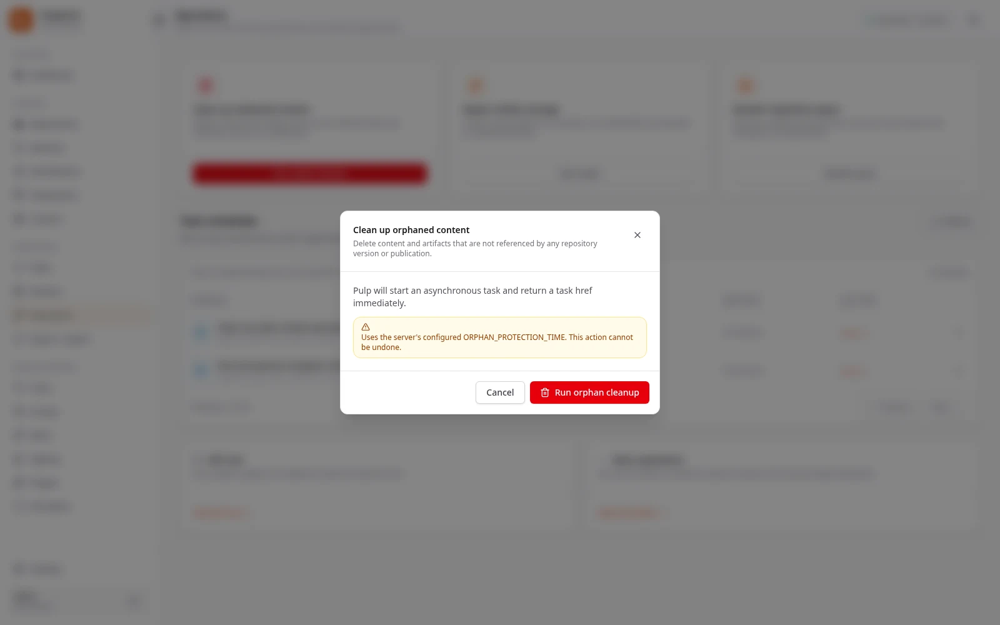

# Operations

The Operations screen collects maintenance work that is easy to forget and easy to run with the
wrong arguments. Each action starts an asynchronous Pulp task, and the result is visible in the task
list.

## Maintenance actions

| Action | Endpoint | What it does | Cautions |
| --- | --- | --- | --- |
| Clean up orphaned content | `orphans/cleanup/` | Deletes content and artifacts that no repository version or publication references | Irreversible; honours the server's `ORPHAN_PROTECTION_TIME` |
| Repair artifact storage | `repair/` | Verifies stored artifacts and tries to redownload missing or corrupted files | Checksums are verified for every artifact, so large installs take a while |
| Reclaim repository space | `repositories/reclaim_space/` | Removes unreferenced versions and content from storage across all repositories | Versions protected by a retain policy are preserved |

Every action opens a confirmation that explains the effect and the caveat before anything runs. The
orphan-cleanup confirmation is styled as destructive because there is no undo.

After you confirm, the page reports the started task and links to it. Progress, errors, and created
resources live on the task detail page — this screen does not poll each operation separately.

## When to run which

- **Orphan cleanup** after deleting repositories, distributions, or publications, or after uploading
  content that never made it into a version. Run it during a quiet window: on a busy instance the
  task spends time waiting for the task lock.
- **Repair** when a client reports a checksum mismatch or a 404 on content that should exist, or after
  restoring storage from a backup.
- **Reclaim space** when storage grows without new content, for example after removing large
  repository versions. Check retention settings first; reclaim cannot remove protected versions.

All three actions are installation-wide. There is no per-repository reclaim control in the UI —
scoped reclaim is available through [API admin](administration.md#api-admin) if you need it.

## Task schedules

The lower half of the page lists recurring work registered by Pulp and its plugins, read from
`task-schedules/`.

| Column | Meaning |
| --- | --- |
| Schedule | The scheduled task's readable name, with the raw task type beneath |
| Interval | How often it dispatches, in `days HH:MM:SS` form |
| Next run | When the next dispatch is due, relative to now |
| Last task | A link to the most recent run, plus a raw API action |

Schedules are created by plugins and by server-side configuration; this page does not create or
edit them. A typical installation has at least stale-content cleanup and anonymous-analytics tasks.

## API root and the escape hatch

The bottom cards link to the Pulp API root and to API admin. Use them when a maintenance endpoint
does not have a curated control yet — the API root lists every endpoint the installation exposes,
and API admin can send requests with your current session.

---

Next: [Users, groups, and roles](rbac.md)
