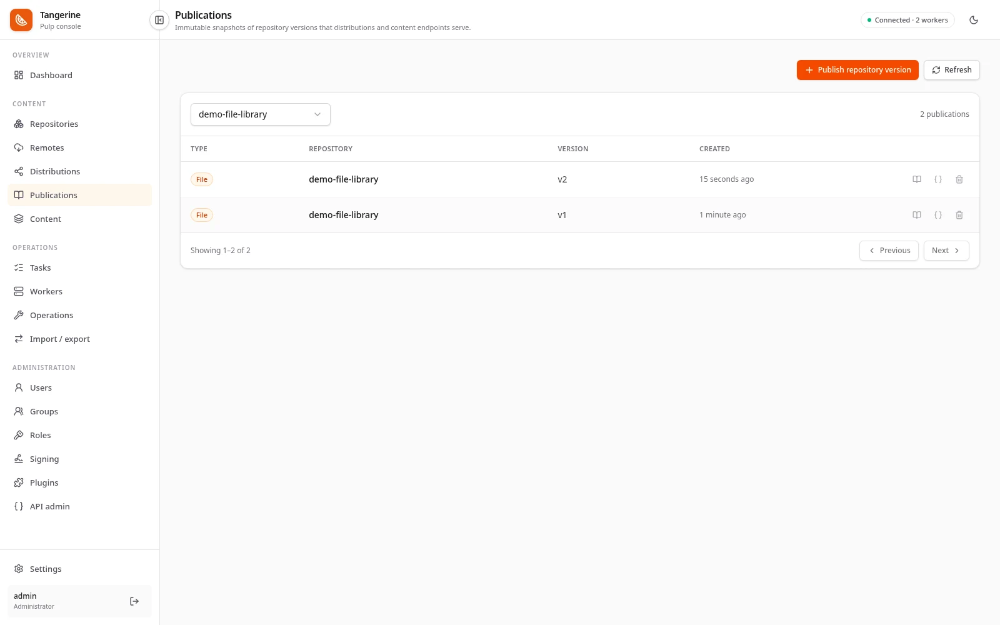
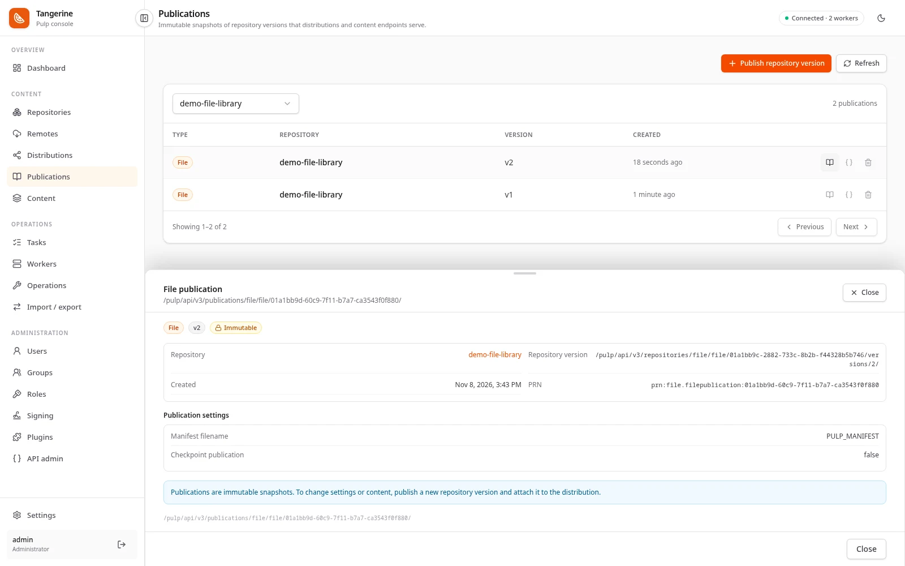
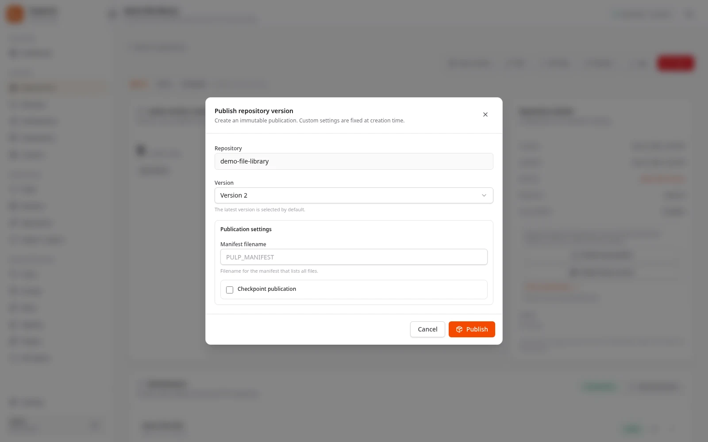

# Publications

Publications are immutable snapshots of a repository version. Distributions serve them, and they
never change after creation: new content means a new publication.

## The publication list

The page reads the combined `/publications/` endpoint, which is read-only and intentionally thin.
It shows type, repository, version number, and creation time.

- **Repository filter** narrows the list to one repository. The choice is kept in the URL, so the
  view survives a reload.
- **Publish repository version** creates a new publication without leaving the page.
- Row actions open the detail pane, show raw API data, or delete the publication.

Type is derived from the publication href, because the combined response omits `pulp_type`. The
repository is resolved through the repositories list, and the version number comes from the
`repository_version` href.

## Publication detail

Selecting a publication opens the shared bottom pane. It shows:

- plugin type label (for example File or RPM), version number, and an **Immutable** badge;
- repository and repository version links;
- creation timestamp and PRN;
- the plugin's publication settings — for File, the manifest filename and checkpoint flag;
- a reminder that settings cannot be edited, only replaced by a new publication.

The pane is resizable by dragging its top handle or with the keyboard. Escape closes it.

## Publishing a version

There are three entry points, all opening the same dialog:

1. **Publish repository version** on this page (repository and version are chosen in the dialog).
2. **Publish latest version** on a repository detail page.
3. **Publish latest version** on a distribution whose repository supports publications.

The dialog asks for:

| Field | Notes |
| --- | --- |
| Repository | Required when opened from the publications page |
| Version | Defaults to the newest version |
| Publication settings | Plugin-specific fields generated from the live schema |

Pulp returns a task for publication creation. Tangerine waits for it before refreshing, so a new
publication appears immediately rather than after an unexplained delay.

Publication settings are fixed at creation time. To change the manifest filename or any other
option, publish a new version with the new settings and point the distribution at it.

## Deleting a publication

Delete asks for confirmation — no typing required — and warns that distributions referencing the
publication may stop serving content. The dialog repeats the publication href and repository
version so you can confirm you picked the right one.

Deletion uses the plugin-specific href because the combined endpoint only supports reads. If a
distribution still references the publication, Pulp may refuse and the API error is shown verbatim.

## Why publications matter

For publication-based types (File, RPM, Debian, Python, Gem), a distribution serves a specific
publication. That gives you two useful modes:

- **Follow the repository** — the distribution always serves the newest publication. New versions
  become visible as soon as they are published.
- **Pin a publication** — the distribution serves one frozen snapshot, ideal for reproducible
  installs.

Direct-serve types (Container, Ansible, NPM, Maven, Hugging Face) do not use publications at all.
Their distributions expose repository content directly, so this page will show nothing for them.

See [Repositories](repositories.md#publishing) for auto-publish versus manual publishing, and
[Distributions](distributions.md#content-source) for switching a client endpoint between the two
modes.

---

Next: [Content](content.md)
