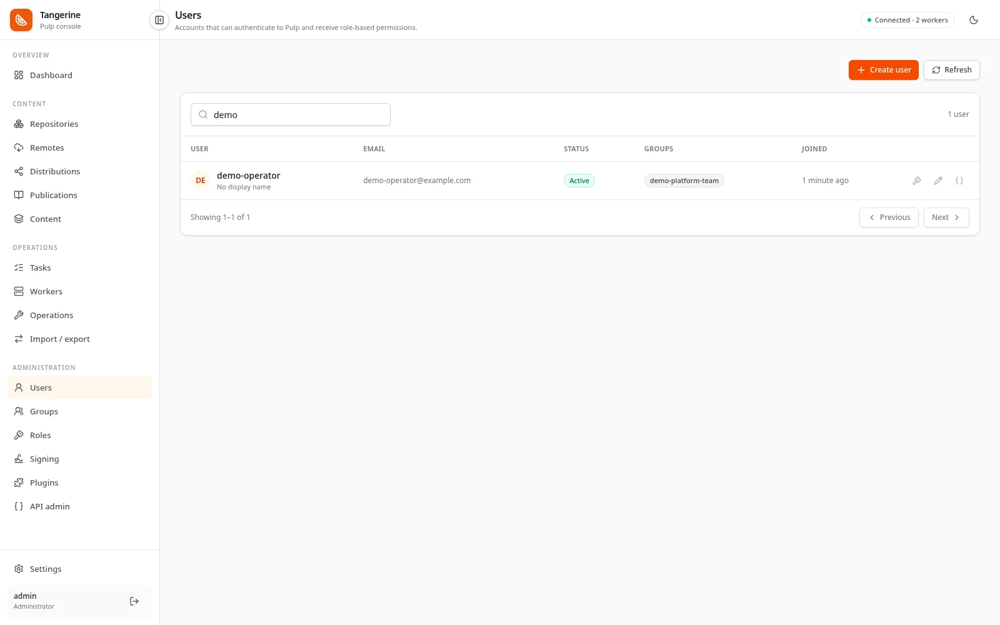
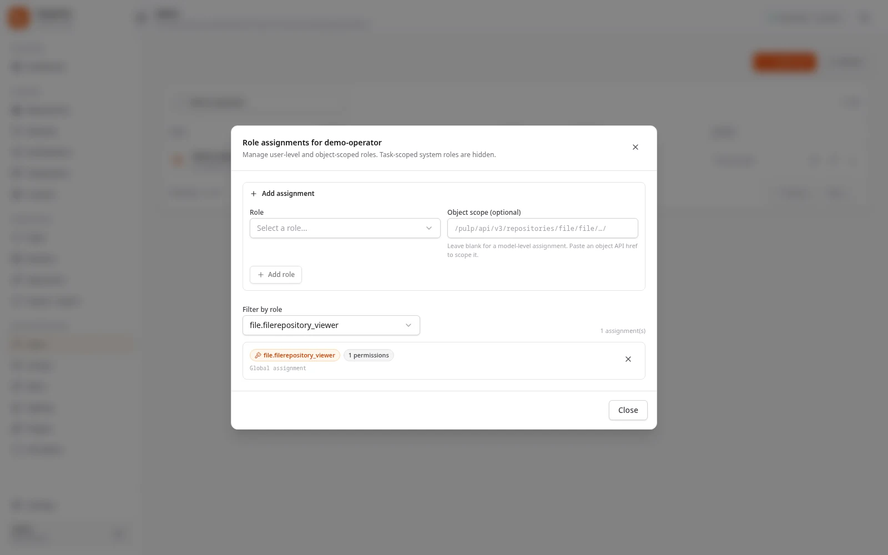
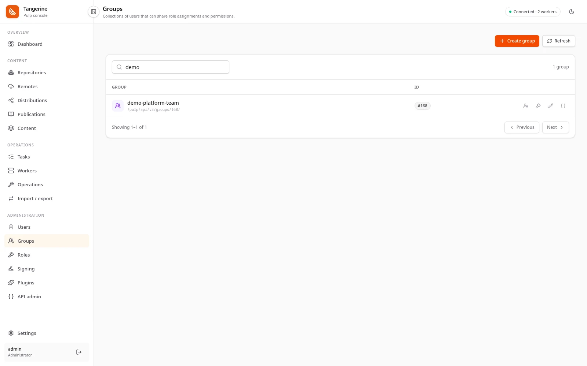
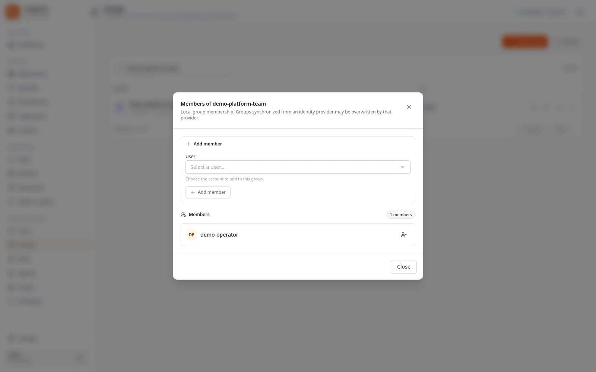
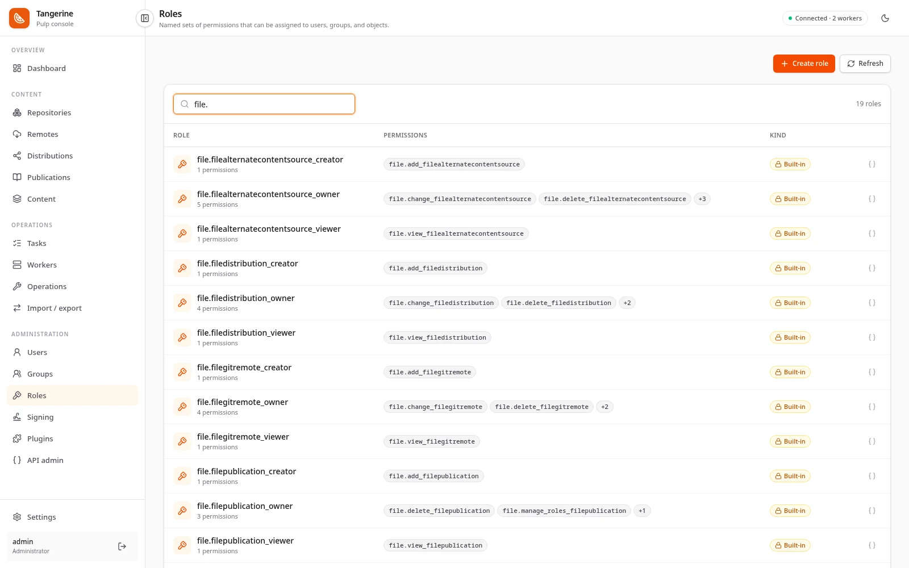

# Users, groups, and roles

Pulp's permission model has three moving parts: accounts, groups that collect accounts, and roles
that grant permissions. Tangerine exposes all three, plus the object-level assignments that scope a
role to one repository or distribution.

## Users

The Users page lists accounts from `users/` with username, email, groups, join time, and status.

- **Search** uses `username__contains` and keeps the term in `?q=`.
- **Create user** asks for username, password, optional first and last name, and email. New accounts
  are not staff by default.
- **Edit** changes the profile and, when the account is locally managed, optionally sets a new
  password.
- **Manage roles** opens the assignment dialog.
- **`{}`** shows the raw account record.

Accounts provisioned by the SSO gateway are marked as managed. Tangerine hides local password
management for them, because the gateway owns the credential. Whether an account is "managed" is
determined by membership in the configured `ssoManagedGroup`, since Pulp does not expose
`has_usable_password`.

Deleting users is not offered in the UI; use [API admin](administration.md#api-admin) if you really
need to remove an account.

### Role assignments

The assignment dialog has two halves:

- **Add assignment** picks a role and an optional object scope. Leave the scope blank for a
  model-level (global) role; paste an object API href to scope it to one repository, distribution,
  or other resource.
- **Filter by role** lists the current assignments for the chosen role. Select a role to see who
  holds it and remove individual assignments.

Task-scoped system roles (`core.task_*`) are hidden from both pickers. They control who may run
which task and are managed separately, so showing them here would invite accidental grants.

For accounts in `ssoManagedGroup`, the dialog shows a **Managed by SSO** notice and hides the
add/remove controls. Change the provider access rules in Settings → SSO instead. Group membership
and object-role changes for managed accounts are blocked the same way.

Global assignments and object assignments are independent: granting a role on one repository does
not affect the account's global permissions, and removing an object assignment leaves any global
role untouched.

## Groups

Groups collect accounts so permissions can be granted once. The list shows the group name, member
count, and update time.

- **Create group** needs only a name.
- **Edit** renames the group.
- **Manage members** adds or removes accounts.

### Membership

The members dialog adds a user through a searchable picker and lists current members with a remove
action. Both directions are confirmed, and the API state is refreshed after the change. Accounts in
`ssoManagedGroup` cannot be added or removed here; the gateway owns their membership.

Group role assignment works exactly like user assignment: a role granted to a group applies to all
members. If the gateway manages a group from an access rule, membership and group roles are
reconciled at login (and optionally by the background replay).

## Roles

Roles are named permission sets. The list shows each role's name, its permissions, and whether it is
built-in or custom.

- **Create role** asks for a name, an optional description, and a list of permissions such as
  `file.add_filerepository`.
- Built-in roles cannot be edited or deleted; they are recreated by plugins on upgrade.
- Custom roles can be edited and deleted from the role detail dialog.
- Selecting a role opens a dialog with the full permission list and a link to its raw API data.

Role names follow a plugin convention: `<plugin>.<resource>_<creator|viewer|owner>`. For example
`file.filerepository_viewer` allows reading File repositories, while `_owner` adds change and delete
permissions.

### Object roles on a resource

Repository and distribution detail pages include a **Roles and permissions** card. It assigns a role
to a user or group **on that object** without granting anything globally. This is the safest way to
give a team access to one repository:

1. Open the repository.
2. Choose a role and whether to assign to a user or a group.
3. Search for and select the subject, then **Assign role**.
4. Assigned object roles appear below the form and can be removed individually.

## Practical recipes

**Give a team read-only access to one repository.** Create a group, add the team's accounts, then
assign `file.filerepository_viewer` on that repository to the group.

**Let an operator publish.** Assign the plugin's publisher role (for File,
`file.filepublication_creator`) globally or on the specific repository.

**Audit who can change a repository.** Open the repository's roles card. It lists object
assignments; global assignments are visible from each user's or group's role dialog.

---

Next: [Import and export](import-export.md)
