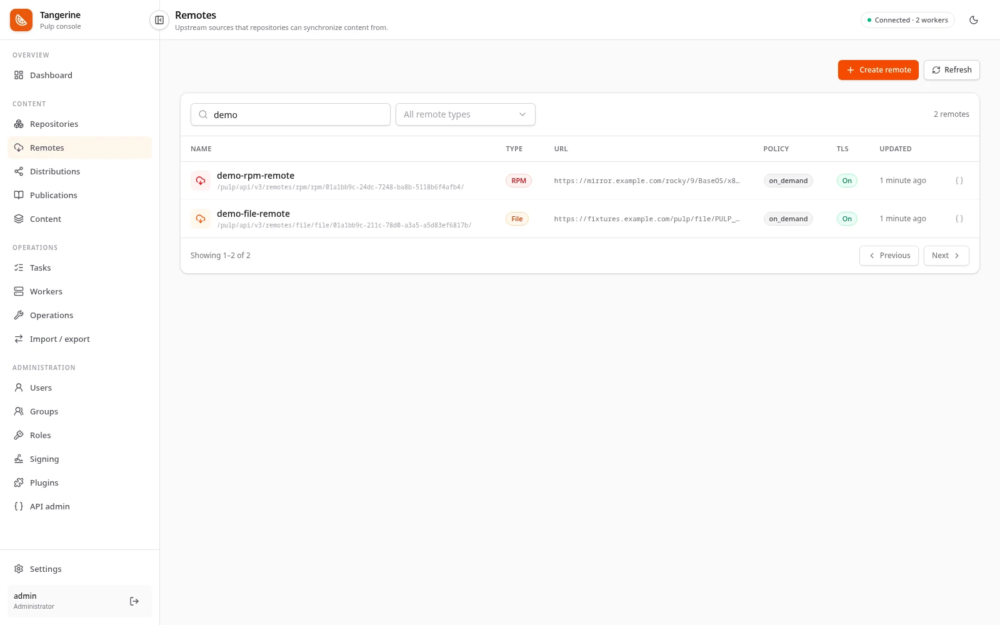
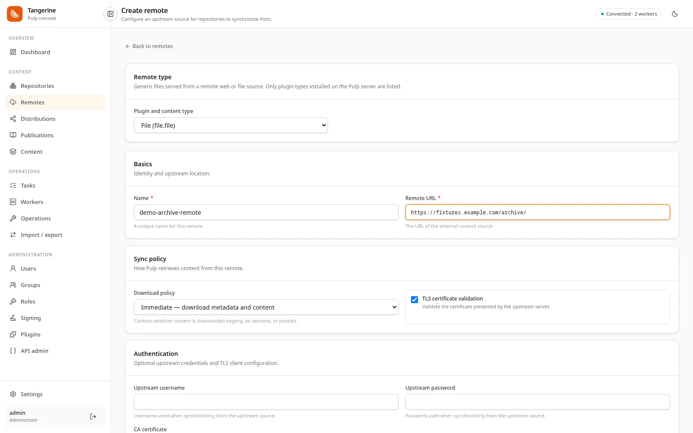
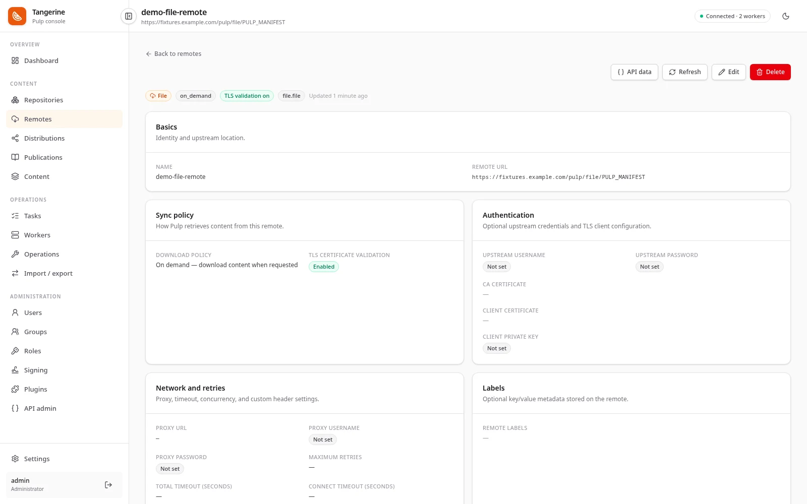

# Remotes

Remotes describe where content comes from: an upstream repository, a registry, or a file server.
They are reusable — one remote can be attached to several repositories, and a repository sync uses
whichever remote is attached to it.

## The remote list

The list shows the combined `/remotes/` endpoint with name, plugin type, upstream URL, download
policy, TLS verification state, and last update.

- **Search** filters by name (`name__contains`), stored as `?q=` in the URL.
- The **type filter** narrows the list to a single remote type, useful on installations with many
  plugins. Options come from the installed plugins, not a hardcoded list.

## Creating a remote

**Create remote** opens a full-page form rather than a dialog, because plugin remotes have long
field lists.

1. Choose the **plugin and content type**. Each entry maps to `remotes/<plugin>/<type>/`. Only
   installed plugins are offered.
2. Fill the fields. They are generated from the live OpenAPI schema, so the form matches the exact
   version of the plugin running on your server — RPM shows sync policy and metadata options,
   Python shows package types, Container shows registry and token settings, and so on.
3. Values are validated client-side where the schema allows it: required fields are marked, numbers
   must be numbers, JSON fields must parse, and key/value fields use one `key=value` pair per line.

Common fields you will meet:

| Field | Notes |
| --- | --- |
| Remote URL | The upstream base. Required for most types |
| Download policy | `immediate`, `on_demand`, or `streamed`. `streamed` is only valid for some types |
| TLS certificate validation | Leave on unless the upstream uses a self-signed certificate |
| Upstream username / password | Write-only credentials |
| CA / client certificate / client key | PEM material for mutual TLS |
| Proxy URL, proxy credentials | Per-remote proxy |
| Timeouts, retries, concurrency | Tuning for slow or rate-limited upstreams |
| Extra headers | Custom request headers, one per line |

If creation fails, the API message is shown verbatim. A `400` for an unknown field usually means
the plugin version on the server differs from the form; reload the page to pull a fresh schema.

## Remote detail

The detail page groups the remote's configuration into readable cards instead of one long list:

- **Basics** — name and upstream URL.
- **Sync policy** — download policy and TLS validation, with a plain-language explanation of the
  policy.
- **Authentication** — upstream username and password state, plus certificates.
- **Network and retries** — proxy settings, timeouts, retries, concurrency, rate limit.
- **Labels** — optional key/value metadata.

The header buttons are **Edit**, **API data**, **Refresh**, and **Delete**. Editing opens the same
schema-driven form as creation, pre-filled from the current record.

### Write-only secrets

Pulp never returns passwords, tokens, client keys, or proxy credentials. Instead each response
carries `hidden_fields` entries describing which secrets are set.

Tangerine therefore shows `Not set` or `Configured` rather than a masked value, and the edit form
sends a secret **only if you type a new one**. Leaving the field blank keeps the stored credential;
there is no way to read it back. This is deliberate — do not expect the form to display the current
password.

### Deleting a remote

Delete asks for confirmation and explains that repositories using the remote will no longer be able
to sync. Pulp may return a task; the UI waits for it before refreshing.

---

Next: [Distributions](distributions.md)
