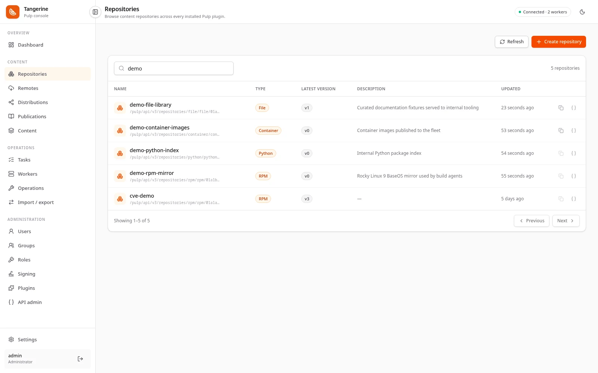
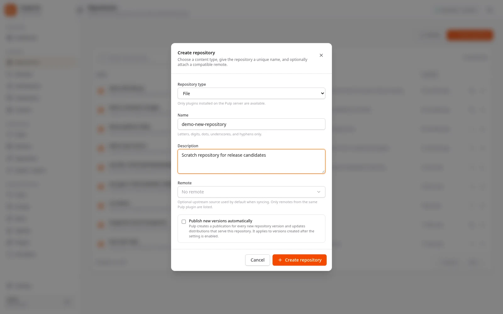
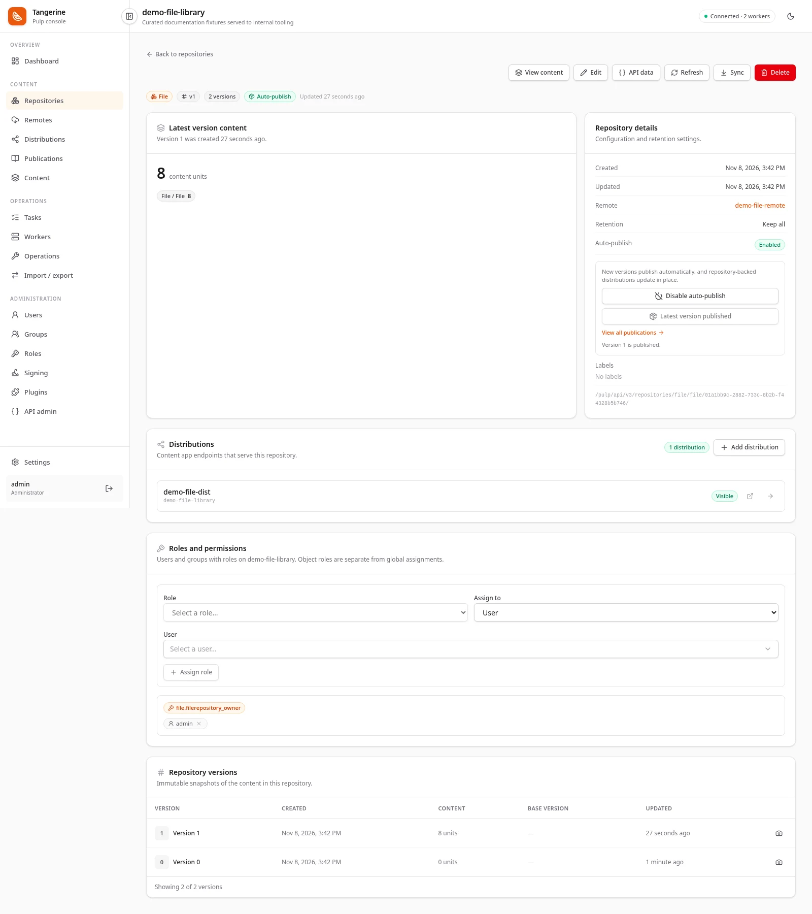
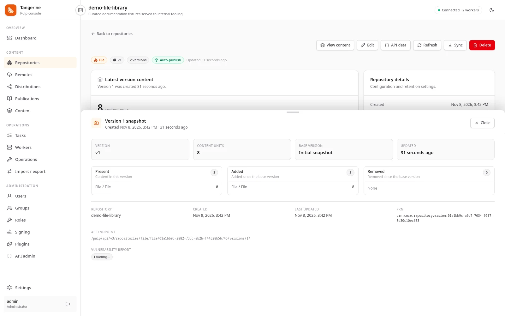
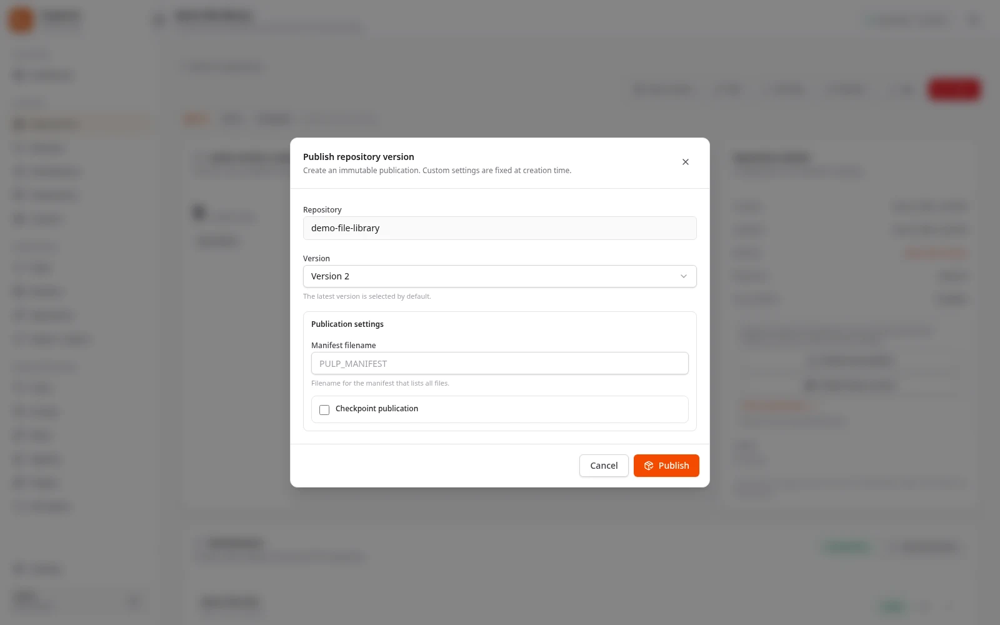

# Repositories

A repository is where Pulp stores content versions. Tangerine exposes one combined list across
every installed plugin and opens a plugin-aware detail page for each repository.

## The repository list

The list offers a rows-per-page selector (25, 50, or 100) and sortable Name and Updated columns.
Page size, page number, search, and sort order are all kept in the URL, so a refresh or a detail
page Back link restores the same view.

The list shows the combined `/repositories/` endpoint: name, API href, type badge, latest version
number, description, and update time.

- **Search** filters by name using server-side `name__contains`. The term is stored in the URL as
  `?q=`, so a refresh or a Back navigation keeps the filter.
- **Pagination** is server-side through `?page=`, with 25 rows per page. List state never leaks to
  another screen.
- The **copy** action copies every distribution URL attached to that repository, one per line. It
  is the quickest way to hand a client the endpoints it needs.
- The **`{}`** action opens the raw API record in the shared bottom pane instead of a new tab.

### Creating a repository

**Create repository** opens a single dialog that adapts to the chosen type:

1. Pick a **repository type**. Only plugins installed on the server appear; each option maps to that
   plugin's `repositories/<plugin>/<type>/` endpoint.
2. Enter a **name** — letters, digits, dots, underscores, and hyphens. Pulp enforces uniqueness
   within the type.
3. Optionally add a **description** and attach a **remote**. Remote options are filtered to types the
   selected repository can sync from; same plugin is not enough, so a container repository never
   offers a pull-through remote it cannot use.
4. On File, RPM, Debian, and Python repositories you can enable **Publish new versions
   automatically**. This maps to Pulp's `autopublish` flag and only affects versions created after
   it is turned on.
5. On RPM repositories, **OSV vulnerability scanning** adds the `osv_config` entries the scan task
   needs. Each row is an ecosystem (Rocky Linux, AlmaLinux, Red Hat, openSUSE, and the other OSV
   ecosystems Pulp supports) plus its releases. Leave it empty to keep scanning off; every release
   entry triggers one OSV query per package.

The type list covers File, RPM, Debian, Python, Container, Ansible, Gem, Maven, NPM, and Hugging
Face when those plugins are present. If a type is listed but the plugin is missing, creation fails
with an explanatory message instead of a silent no-op.

## Repository detail

The detail page pulls the plugin-specific repository record, not the combined one. That matters
because the combined response omits fields such as `autopublish`.

**Header actions**

| Action | What it does |
| --- | --- |
| Edit | Changes name, description, remote, and (where supported) auto-publish |
| API data | Shows the plugin-specific JSON in the bottom pane |
| Remote | Opens the attached remote's detail page, when one is set |
| Sync | Starts `POST <repository>/sync/` using the configured remote |
| Delete | Confirmation that requires typing the repository name |

**Latest version content** summarises the newest version: total content units and a count per
content type. A repository with no versions says so instead of showing an empty table.

**Repository details** shows created/updated timestamps, the remote, retention behaviour,
auto-publish state, labels, and the API href.

**Distributions** lists every distribution serving this repository, with its base path and
visibility. When none exists, the card offers a create form pre-filled with a unique name and base
path. Once one exists, **Add distribution** stays available, so a repository can expose several
endpoints. Distribution creation never overwrites an existing name or base path.

**Roles and permissions** assigns object-scoped roles on this repository — separate from global
assignments. See [Users, groups, and roles](rbac.md).

**Repository versions** lists immutable snapshots newest first, with content counts, base version,
and update time. Each row has a snapshot button.

### Version snapshots

The snapshot button opens the shared bottom pane with:

- the version number, content-unit total, base version ("Initial snapshot" for the first one), and
  when it was created;
- **Present**, **Added**, and **Removed** summaries by content type;
- repository name, creation and update timestamps, and the PRN;
- the version API endpoint and its vulnerability summary: severity chips when a scan found
  advisories, **Clean** when it found none, or **Not scanned**;
- a footer **Scan for vulnerabilities** action that starts Pulp's scan task for that version.

The pane is resizable: drag its top handle, or focus the handle and use the arrow keys, Home, and
End. Escape closes it.

## Scanning for vulnerabilities

RPM and Python repositories can be scanned for known vulnerabilities. Pulp stores one
vulnerability report per content unit and exposes it through the package's `vuln_report` field; the
content browser turns those reports into per-version CVE badges.

- For RPM, configure **OSV vulnerability scanning** in Create or Edit first. Without `osv_config`,
  **Scan** is disabled with an explanation.
- **Scan** in the repository header scans the latest version; the version snapshot pane scans that
  specific version. Both start an asynchronous task and link to it.
- Scans contact `api.osv.dev`; a blocked network leaves versions **Not scanned**. The task's error
  names the failure.
- Re-scanning updates the existing reports in place. Reports are content-level, so the same package
  version shows the same advisories in every repository.
- Python repositories use their own scan endpoint and remote `vulnerabilities` flag; no OSV
  configuration is needed.

## Syncing

**Sync** opens a small confirmation that explains what will happen: Pulp starts an asynchronous
task using the repository's configured remote. If no remote is attached, the task fails — Tangerine
does not invent one.

On success a banner links straight to the started task. Syncs download metadata and, depending on
the remote's policy, content. Progress and errors appear on the task detail page.

## Publishing

Pulp has two ways to make repository content consumable:

- **Auto-publish** — Pulp creates a publication whenever a new version appears. Supported on File,
  RPM, Debian, and Python repositories. The card in the sidebar switches it on or off.
- **Manual publish** — create a publication for a specific version.

**Publish latest version** opens the publication dialog for the newest version. It shows the
repository, the version selector (latest by default), and the publication settings that the plugin
accepts — for File that is the manifest filename and a checkpoint flag. Settings are fixed at
creation time because publications are immutable.

Not every type uses publications:

| Repository type | Publishing |
| --- | --- |
| File, RPM, Debian, Python | Auto-publish or manual publication; distributions serve publications |
| Gem | Manual publication; no auto-publish |
| Container, Ansible, NPM, Maven, Hugging Face | Content served directly by distributions; publications are not used |

When a type does not use publications, the detail page says so instead of showing controls that
would fail. Hugging Face is a special case: publication creation is broken in the upstream plugin,
so Tangerine treats its distributions as direct-serve.

Two behaviours are worth remembering:

- Enabling auto-publish does **not** publish versions that already exist. Use **Publish latest
  version** once after turning it on, or the next new version will publish while the current one
  stays unpublished.
- Disabling auto-publish stops future publications but leaves existing publications and
  distributions untouched. Repository-backed distributions keep serving the last publication.

For the publications themselves — filtering, inspecting, deleting — see
[Publications](publications.md).

## Deleting a repository

Delete is destructive and guarded: the confirmation requires typing the exact repository name.
Pulp may delete synchronously or return a task; Tangerine waits for the task before refreshing the
list. Distributions or publications that still reference the repository can make deletion fail, and
the API error is shown as-is so you can remove the dependants first.

---

Next: [Remotes](remotes.md) · [Distributions](distributions.md)
