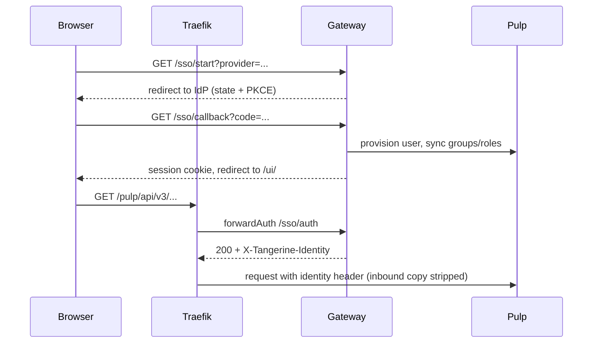

# Single sign-on

Tangerine can broker OpenID Connect (OIDC) for a stock Pulp installation. The UI
is static and cannot complete an OIDC exchange, and Pulp has no token-exchange
endpoint, so the flow runs in a small Python service in `gateway/`. The gateway
owns the OIDC session and answers Traefik `forwardAuth` requests with an identity
header that Pulp reads through `JSONHeaderRemoteAuthentication`.

SSO is optional. The default is Pulp's local session login. This guide walks
through a complete gateway deployment, Pulp configuration, provider
registration, access rules, verification, and troubleshooting.



## Before you begin

You need:

- a public HTTPS origin for the UI and API, for example
  `https://pulp.example.com`;
- Traefik (or an equivalent ingress that supports forwardAuth);
- a PostgreSQL database for the gateway, separate from Pulp;
- a Pulp superuser service account for the gateway;
- an OIDC application at your identity provider;
- an ingress that can strip a request header before forwardAuth;
- a CNI that actually enforces NetworkPolicy.

> [!warning] The identity header is unsigned
> Pulp trusts the header the gateway injects. The only barriers are ingress
> header stripping and enforced network policy. Do not use this gateway on a
> cluster whose CNI ignores NetworkPolicy.

## 1. Choose the authentication mode

| Mode | Use when | Behaviour |
| --- | --- | --- |
| `session` | Local admin or no SSO | Pulp username/password form |
| `external` | An ingress already authenticates users | Unauthenticated visitors redirect to `externalLoginUri` |
| `gateway` | You want provider buttons and Pulp identity | Provider login through the gateway |

For this guide, set `config.authMode: gateway` and keep
`config.passwordLoginEnabled: true` for break-glass access unless you have a
separate local admin path.

Gateway mode never auto-redirects. Only `external` mode does.

## 2. Prepare the database

Create a dedicated database and user. Do not reuse Pulp's database or Secret.

```sh
kubectl -n pulp create secret generic tangerine-gateway-db \
  --from-literal=POSTGRES_HOST=db.example.com \
  --from-literal=POSTGRES_PORT=5432 \
  --from-literal=POSTGRES_USERNAME=tangerine_gateway \
  --from-literal=POSTGRES_PASSWORD='...' \
  --from-literal=POSTGRES_DB_NAME=tangerine_gateway \
  --from-literal=POSTGRES_SSLMODE=require
```

The chart's `postgres.mode=external` uses this Secret. The bundled single-replica
PostgreSQL StatefulSet is for evaluation only; use a managed database for HA.

## 3. Create the gateway secrets

The gateway stores provider secrets as files, never in the database.

```sh
kubectl -n pulp create secret generic tangerine-idp-secrets \
  --from-file=google-client-secret \
  --from-file=microsoft-client-secret
```

- Each provider's client secret is a file name referenced by the provider row.
- A Google client-secret file must contain the raw secret value, not the
  downloaded OAuth JSON.
- The Microsoft secret file is the secret **value**, not the secret ID.

Optional token encryption:

```sh
kubectl -n pulp create secret generic tangerine-token-key \
  --from-literal=TOKEN_ENCRYPTION_KEY="$(openssl rand -base64 32)"
```

When set, the gateway encrypts stored ID tokens and can pass
`id_token_hint` on logout.

Create the gateway's Pulp service-account Secret:

```sh
kubectl -n pulp create secret generic tangerine-gateway-auth \
  --from-literal=PULP_PASSWORD='...'
```

The service account must be a Pulp superuser; Pulp has no narrower permission for
user administration. Never use a human administrator account.

## 4. Deploy the gateway

```sh
helm upgrade --install tangerine oci://registry-1.docker.io/oneinchlunch/tangerine \
  --version 0.2.4 --namespace pulp \
  --set image.tag=0.1.4 \
  --set config.authMode=gateway \
  --set ingress.hosts[0].host=pulp.example.com \
  --set ingress.tls[0].secretName=pulp-tls \
  --set gateway.enabled=true \
  --set gateway.externalBaseUrl=https://pulp.example.com \
  --set gateway.pulpUrl=http://pulp-api-svc:24817 \
  --set gateway.existingSecret=tangerine-gateway-auth \
  --set gateway.secretFilesSecret=tangerine-idp-secrets \
  --set gateway.managedGroup=sso-managed \
  --set gateway.adminGroup=tangerine-admins \
  --set gateway.superadminGroup=tangerine-maintainers \
  --set postgres.mode=external \
  --set postgres.externalSecret=tangerine-gateway-db \
  --set gateway.tokenEncryptionKeySecret=tangerine-token-key
```

Key values:

| Value | Meaning |
| --- | --- |
| `gateway.externalBaseUrl` | Public origin used for the callback URI |
| `gateway.pulpUrl` | Pulp API service (`pulp-api-svc:24817`) |
| `gateway.existingSecret` | Secret with `PULP_PASSWORD` |
| `gateway.secretFilesSecret` | Secret mounted at `/run/tangerine/secrets` |
| `gateway.managedGroup` | Marker group for provider-managed accounts |
| `gateway.adminGroup` | Pulp group mapped to staff, repository-scoped admins |
| `gateway.superadminGroup` | Pulp group mapped to superusers |
| `gateway.tokenEncryptionKeySecret` | Optional Fernet key Secret |

The chart creates the gateway Deployment, Service, Ingress, Traefik middlewares,
and NetworkPolicy. Every gateway resource is conditional on
`gateway.enabled`; with SSO off, no gateway pod or gateway database is created.

## 5. Configure Pulp

Pulp must accept the identity header. With Pulp Operator, create a ConfigMap and
reference it with `spec.custom_pulp_settings`. The field is **not**
`spec.pulp_settings`.

```sh
kubectl -n pulp create configmap pulp-sso-settings \
  --from-literal=authentication_backends='["django.contrib.auth.backends.ModelBackend", "pulpcore.backends.ObjectRolePermissionBackend", "pulpcore.app.authentication.PulpNoCreateRemoteUserBackend"]' \
  --from-literal=rest_framework__default_authentication_classes='["pulpcore.app.authentication.BasicAuthentication", "rest_framework.authentication.SessionAuthentication", "pulpcore.app.authentication.JSONHeaderRemoteAuthentication"]' \
  --from-literal=authentication_json_header='"HTTP_X_TANGERINE_IDENTITY"' \
  --from-literal=authentication_json_header_jq_filter='".user"'

kubectl -n pulp patch pulp pulp --type merge \
  -p '{"spec":{"custom_pulp_settings":"pulp-sso-settings"}}'
```

Keys are uppercased by the operator; values are Python literals. The identity
class must be **last** in the authentication list; otherwise anonymous requests
return `403` instead of `401` and the UI cannot distinguish "signed out" from
"not permitted".

For an all-in-one Pulp deployment, add the same settings to its settings file and
restart the pods. Settings are read at startup.

Restrict who can reach the Pulp API at the network layer. Only the ingress and
the gateway should be able to connect. The `pulp` chart and the gateway chart
include NetworkPolicy resources; verify they are enforced.

## 6. Wire Traefik

The gateway creates two Middlewares:

1. `strip-identity` — removes any client-supplied `X-Tangerine-Identity`;
2. `forward-auth` — asks the gateway who the caller is and injects the header.

Attach both to a dedicated `/pulp` router, strip-first:

```yaml
traefik.ingress.kubernetes.io/router.middlewares: pulp-tangerine-gateway-strip-identity@kubernetescrd,pulp-tangerine-gateway-forward-auth@kubernetescrd
```

With Pulp Operator, the operator creates a single Prefix `/` Ingress to
`pulp-web-svc`. A middleware annotation on that object would also cover `/v2`
and `/token`, which would break container registry pulls during a gateway
outage. Replace it with two Ingresses that share the same host and TLS Secret:

| Ingress | Paths | Middlewares |
| --- | --- | --- |
| `pulp-api` | `/pulp` | strip-identity, forward-auth |
| `pulp-registry` | `/v2`, `/token` | none |

Do not attach the middlewares to `/v2` or `/token`. If you use a Traefik
`IngressRoute` instead, apply them per route.

Tangerine itself can keep a plain `/ui/` and `/sso/` router. Its Ingress priority
must stay above Pulp's catch-all `/` route.

## 7. Register a provider

Open **Settings -> SSO** as a maintainer (a Pulp superuser). The panel shows
providers, access-rule presets, an access-policy status card, an activity card,
and an admin-only preview login.

Provider fields common to all kinds:

- **Provider id** — a short key used in URLs and rules.
- **Kind** — Google, Microsoft Entra ID, Keycloak, or generic OIDC.
- **Issuer** — the OIDC issuer URL.
- **Client ID** and **secret file name** (not the value).
- **Scopes** — usually `openid profile email`.
- **Username claim** and optional prefix.
- **Group claim** and role claim.
- **Baseline group/roles**, access rules, strict mode, and domain policy.

Use **Discover** to populate endpoints from the issuer. Use **Preview login** to
compute the plan without writing any user, group, or role.

### Google Workspace

1. Create a **Web application** OAuth client in the Google Cloud console.
2. Add the redirect URI `https://pulp.example.com/sso/callback`.
3. Use issuer `https://accounts.google.com`.
4. Scopes: `openid profile email`.
5. Username claim: `email`; prefix `g-` is a useful convention.
6. Require a verified email.
7. Put the raw client secret in `google-client-secret`.
8. For Workspace group sync, enable group lookup and mount a service-account JSON
   key. Authorize its client ID for
   `https://www.googleapis.com/auth/admin.directory.group.readonly` with
   domain-wide delegation. The admin email must be a Workspace super admin.
9. Optional: require the Google `hd` claim and list allowed domains.

Google does not emit group membership in ID tokens; without the service account,
Google sign-in is authentication-only.

### Microsoft Entra ID

1. Register an application; single tenant is recommended.
2. Add the Web redirect URI `https://pulp.example.com/sso/callback`.
3. Set the manifest `groupMembershipClaims` to `SecurityGroup`.
4. Grant delegated `openid profile email User.Read GroupMember.Read.All` and
   admin-consent it.
5. For the group picker and directory sync, grant application
   `Group.Read.All` and `User.Read.All`.
6. Issuer: `https://login.microsoftonline.com/<tenant-guid>/v2.0`.
7. Username claim: `preferred_username`; prefix `ms-`.
8. Group claim: `groups`; role claim: `roles`.
9. Put the secret **value** in `microsoft-client-secret`.
10. Enable the Graph overage lookup if your tenants exceed the token group limit.

Do not require `email_verified`; Entra generally does not emit it. Multi-tenant
authorities (`common`, `organizations`, `consumers`) need an explicit
`allowedTenants` GUID list.

### Keycloak

1. Create an OpenID client with confidential access type.
2. Add `https://pulp.example.com/sso/callback` as a valid redirect URI.
3. Use the realm issuer, for example
   `https://keycloak.example.com/realms/pulp`.
4. Scopes: `openid profile email`.
5. Map the group claim to a client scope or protocol mapper.
6. Put the client secret in a file referenced by the provider.

Keycloak is a good local OIDC provider for development; it avoids committing a
test key and works with the same gateway code path as production providers.

### Generic OIDC

Use this for any standards-compliant provider:

1. Confirm `/.well-known/openid-configuration` is reachable from the gateway.
2. Register the redirect URI.
3. Choose issuer, client ID, secret file, scopes, and claims.
4. If the issuer is plain HTTP, enable `gateway.allowHttpIssuers` only in a
   disposable environment.

## 8. Access rules

Access rules turn asserted claims into Pulp groups and roles.

```json
{
  "accessRules": [
    {
      "claim": "groups",
      "match": "tangerine-admins@example.com",
      "group": "tangerine-admins",
      "roles": ["tangerine-admin-read//", "tangerine-repository-admin//prn:..."]
    }
  ],
  "baseline": { "group": "sso-users", "roles": ["tangerine-viewer//"] },
  "strictGroups": true,
  "allowedEmailDomains": ["example.com"],
  "requireHostedDomain": true
}
```

- Rules match values from the configured claim.
- The baseline applies to every login that reaches the gateway and is **not** a
  login gate.
- Strict mode removes undeclared memberships when the group claim is present. It
  preserves protected groups and groups declared by other enabled providers.
- A missing claim means "no assertion", not "no groups".
- Domain policy runs before any user, group, or role write and applies to the
  preview too.
- Group roles are reconciled to the union declared by all enabled providers.
  Roles assigned outside that set survive.
- Higher tiers do not inherit the baseline viewer tier; scoped admins do not get
  task, worker, or operations permissions.

Restrict who can authenticate at the IdP. Entra uses Enterprise App
**Assignment required**; Google uses OAuth app access or Internal consent. Direct
assignment only authorizes sign-in; asserted groups still choose the tier.

## 9. Pulp roles and access policies

The gateway creates or updates `tangerine-viewer`, `tangerine-maintainer`,
`tangerine-admin`, `tangerine-admin-read`, and `tangerine-repository-admin` from
installed plugin roles. Existing roles are never overwritten.

Apply the read-only access policies once:

```sh
python gateway/scripts/bootstrap_access_policies.py --dry-run
python gateway/scripts/bootstrap_access_policies.py --apply
```

The policies grant read access to users, roles, signing services, tasks,
workers, and import/export for the admin group. Writes stay superuser-only. On a
fresh Pulp, create missing policy records first with
`gateway/scripts/apply_pulp_access_policies.py` inside the Pulp pod; Pulp rejects
creating them over REST.

Repository-scoped admins keep view/sync/scan permissions and write through the
gateway's `/sso/scope/*` endpoints. They do not receive direct
add/change/delete/modify repository permissions, which prevents them from
changing trust fields such as a signing service directly.

## 10. Directory sync and deprovisioning

Login-driven sync is the default. Optional scheduled discovery:

- `sync-directory` fetches Entra app assignments/groups or Google mapped-group
  members, deprovisions unauthorized users, and reactivates returning ones.
- A provider-scoped sync only considers users with an assertion for that
  provider, so Google and Microsoft cannot deprovision each other's accounts.
- `--dry-run` is the default; apply with `--apply` after reviewing the list.
- `prune-identities` prunes from an operator-supplied directory snapshot.

Deprovisioning removes SSO groups and dynamic scopes, disables the user, revokes
gateway sessions, and keeps the managed marker. Login reactivates the user and
reapplies groups, roles, and flags.

Background reconciliation replays the last asserted groups/roles on a timer when
enabled. It repairs manual drift; it does not discover IdP changes without a
login.

## 11. Verify

```sh
curl -fsS https://pulp.example.com/sso/providers
curl -fsS -o /dev/null -w '%{http_code}\n' https://pulp.example.com/sso/session   # 401 when signed out
```

Then:

1. Open `/ui/`; provider buttons appear above the password form.
2. Choose a provider; the browser navigates to `/sso/start?provider=...`.
3. Complete the IdP login; the callback provisions the user and redirects to
   `/ui/`.
4. Confirm the Pulp user's groups, group roles, and `is_staff`/`is_superuser`.
5. Open Settings -> SSO and run a preview login; the diff must match the real
   login.
6. Sign out; the gateway revokes the session and clears Pulp's cookies.
7. Disable a provider; it disappears from `/sso/providers` and existing sessions
   are rejected on the next probe.

## 12. Troubleshooting

| Symptom | Check |
| --- | --- |
| `unauthorized_client` | Redirect URI mismatch, client ID, or secret file |
| Discovery fails | Issuer URL, provider reachability, `allowHttpIssuers` for HTTP |
| Google group search fails | Admin SDK enabled, service-account delegation, admin email |
| Entra `AADSTS50105` | User not assigned to the Enterprise App |
| Groups missing | `groupMembershipClaims`, Graph consent, overage lookup |
| Login succeeds but no roles | Missing access rule or wrong claim value |
| Username collision | Account exists but is not in the managed group |
| `401` then `403` for anonymous | Identity auth class is not last |
| SSO login falls back to local admin | Pulp still has a stale `sessionid`; the gateway should expire it |
| Secret unreadable | File name, Secret mount, and volume propagation |
| Provider disabled but session works | Check `/sso/session` and forwardAuth rejection |

## Security checklist

- [ ] Ingress strips `X-Tangerine-Identity` before forwardAuth.
- [ ] Pulp is reachable only through the ingress and the gateway.
- [ ] NetworkPolicy is enforced; verify from another namespace.
- [ ] `/v2` and `/token` do not use the gateway middlewares.
- [ ] Provider administration is restricted to trusted maintainers.
- [ ] The managed group is set on both the gateway and the UI config.
- [ ] The service account is dedicated and its password is in a Secret.
- [ ] Domain policy and strict mode are enabled deliberately.
- [ ] A preview login was reviewed before the first real login.
