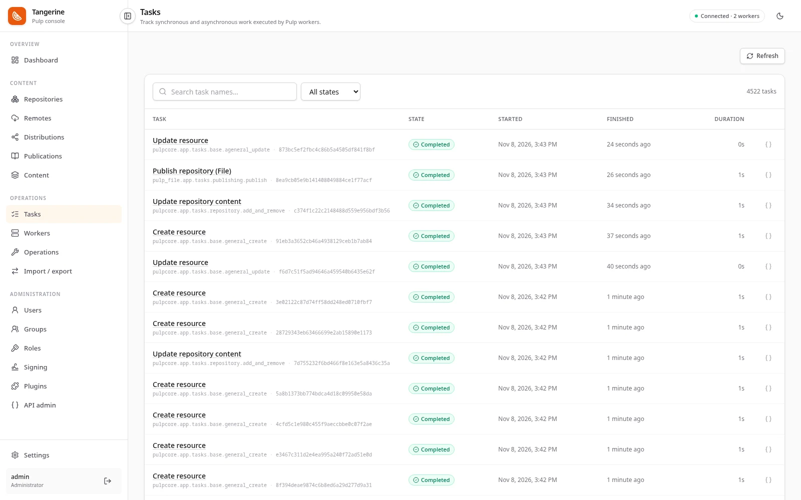
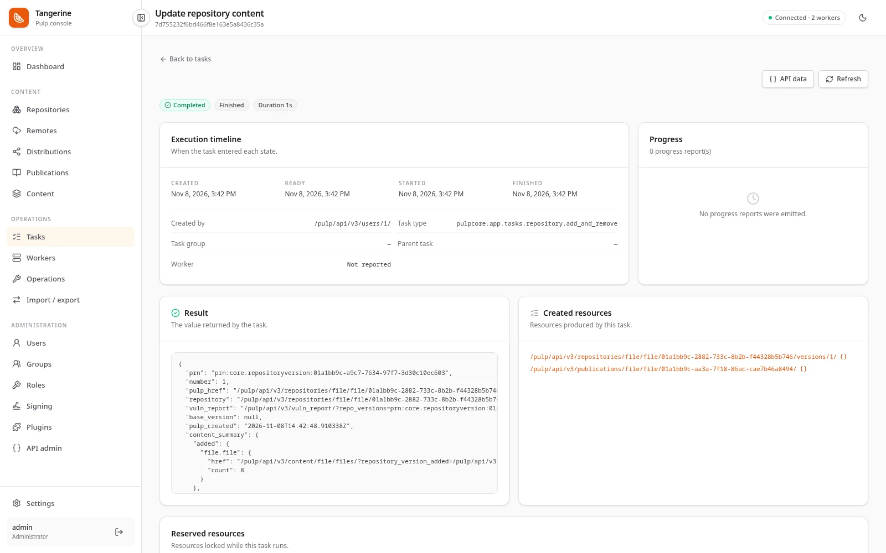
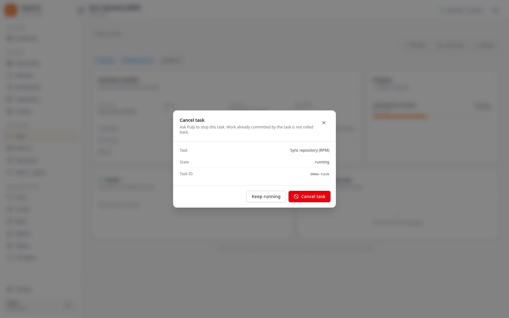
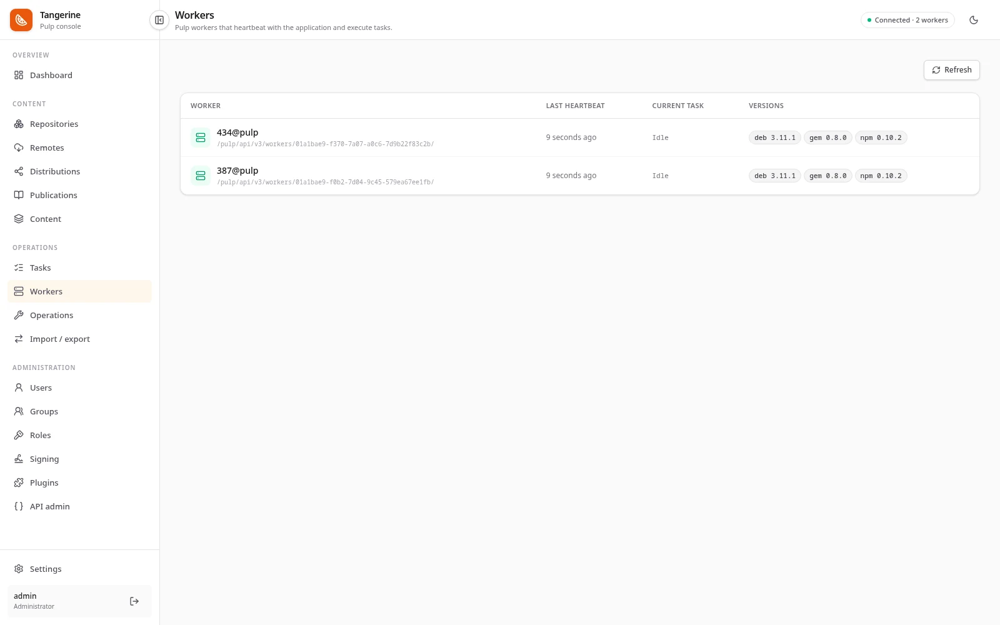

# Tasks and workers

Almost everything in Pulp is asynchronous: syncing, publishing, uploading, deleting, and
maintenance all return a task. Tangerine shows that work in real time and lets you cancel tasks that
support it.

## Task list

The top bar shows a running-task chip whenever Pulp has waiting, running, or cancelling work.
Selecting it opens this page with the state filter set to **Running**.

The list reads `/tasks/` newest first and shows the human-readable task name, the raw task type as
secondary text, state, start time, finish time, and duration.

- **Search task names** filters server-side and is kept in `?q=`.
- **Filter by task state** narrows to waiting, running, completed, failed, canceled, or canceling.
  The choice is kept in the URL as a filter parameter.
- **Pagination** is server-side, so a long history stays navigable.
- Running tasks expose a cancel action in the row.
- The `{}` action opens the raw task record.

Task names are translated from the underlying import paths: `pulp_file.app.tasks.publishing.publish`
becomes *Publish repository (File)*. The raw type stays visible for troubleshooting and log
correlation.

## Task detail

The detail page is built for diagnosis:

| Section | Contents |
| --- | --- |
| Execution timeline | Created, ready, started, and finished timestamps, creator, task type, task group, parent task, worker |
| Progress | Progress reports emitted by the task, with counts and messages |
| Error | The failure description and traceback, when the task failed |
| Result | The JSON value the task returned |
| Created resources | Hrefs of repositories, publications, and units the task produced |
| Reserved resources | Locks the task held, useful when tasks appear stuck behind each other |

The task ID is part of the URL (`/ui/tasks/<task-id>`), so a task link can be shared or pasted into
an incident note. Task detail works even though the checked-in OpenAPI schema does not document the
detail endpoint — the UI calls it directly.

### Cancelling a task

**Cancel task** is only offered while a task is in a cancellable state. The confirmation names the
task and its current state, and warns that work already committed is not rolled back.

Cancellation sends `PATCH` with `{"state": "canceled"}`. Pulp may accept it and move the task to
*canceling* before it stops, or reject it with `409` if the task has already finished. The UI
surfaces whichever answer Pulp gives.

## Workers

The Workers screen lists workers that have heartbeated within Pulp's TTL. Each row shows the worker
name and href, last heartbeat, current task, and the plugin versions that worker loaded.

Use it to answer three questions:

- **Is anything consuming the queue?** No workers online means tasks stay in *waiting* forever.
- **Is one worker stale?** A heartbeat older than the TTL indicates a stopped process; Pulp removes
  the entry once the TTL expires.
- **Do all workers run the same plugin set?** In a mixed deployment, an old worker can pick up a task
  whose plugin version it does not match.

The dashboard health card reports the online worker count; this page explains it.

## Task hygiene

Task history grows without limit unless the deployment prunes it. On a long-lived installation the
count can reach tens of thousands, which is normal but makes search and state filters the practical
way to find a specific run. Pulp's task cleanup and purge endpoints are available through
[API admin](administration.md#api-admin).

---

Next: [Operations](operations.md)
